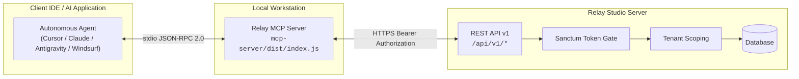
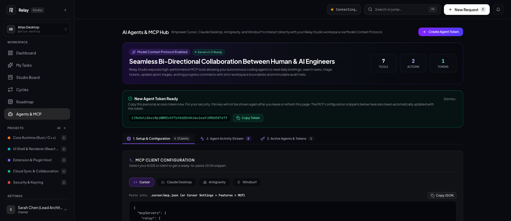
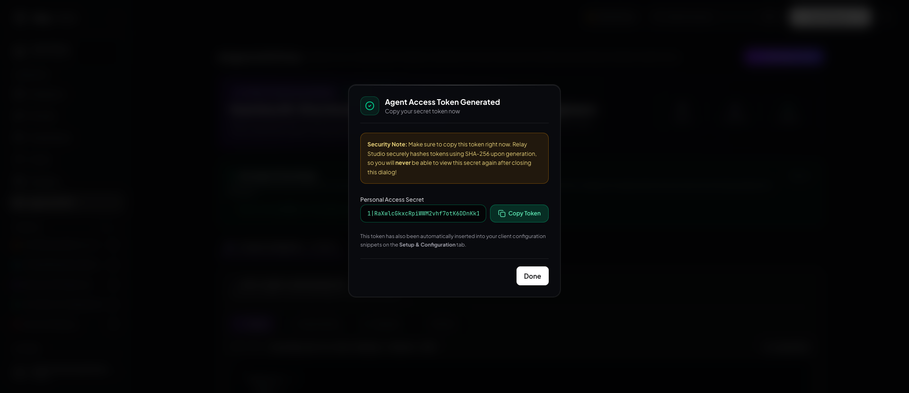
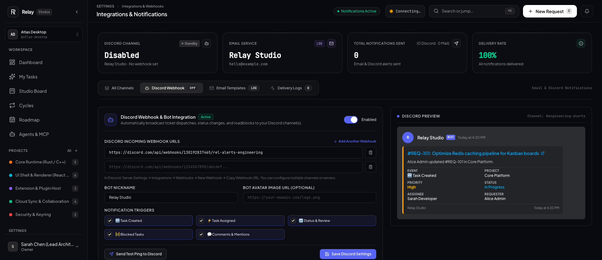
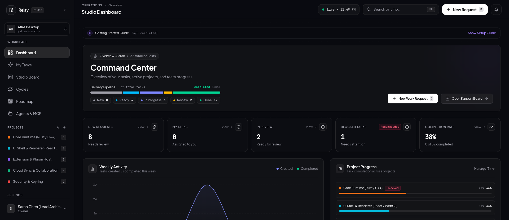
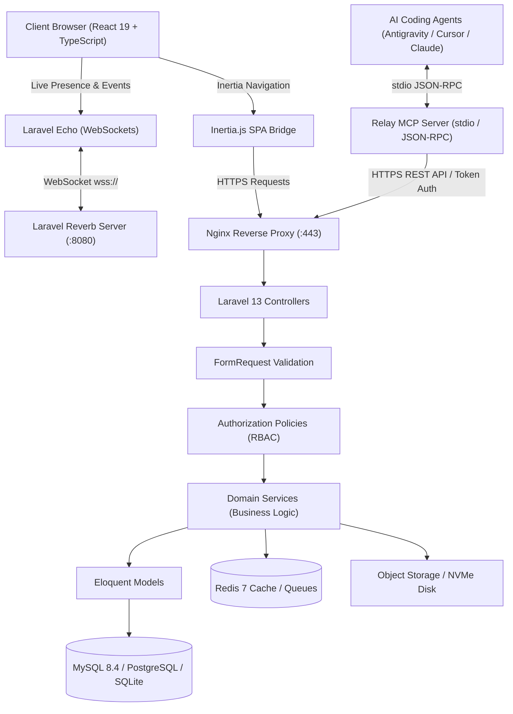

<p align="center">
  
</p>

<p align="center">
  <a href="docs/licensing.md"></a>
  <a href="https://www.php.net/"></a>
  <a href="https://laravel.com/"></a>
  <a href="https://react.dev/"></a>
  <a href="https://www.typescriptlang.org/"></a>
  <a href="https://tailwindcss.com/"></a>
  <a href="https://modelcontextprotocol.io/"></a>
  <a href="https://www.docker.com/"></a>
  <a href="#-verified-technical-benchmarks"></a>
</p>

<p align="center">
  <strong>The self-hosted workspace for software teams and AI coding agents.</strong><br/>
  Linear-inspired speed, complete data sovereignty, and native Model Context Protocol (MCP) integration.
</p>

<p align="center">
  <a href="#-why-relay-studio">Why Relay Studio</a> •
  <a href="#-1-command-quickstart">Quickstart</a> •
  <a href="#-key-capabilities">Capabilities</a> •
  <a href="#-first-party-mcp-ai-assistant-guide">AI &amp; MCP Integration</a> •
  <a href="#-interface-showcase">Showcase</a> •
  <a href="#-system-architecture">Architecture</a> •
  <a href="#-verified-technical-benchmarks">Benchmarks</a> •
  <a href="#-licensing--commercial-tiers">Licensing</a> •
  <a href="#-documentation-suite">Documentation</a>
</p>

---

## ⚡ Why Relay Studio?

Traditional issue trackers force engineering teams into an uncomfortable compromise: surrender your confidential roadmap data to third-party multi-tenant clouds and endure sluggish page transitions, or deploy legacy self-hosted software that requires gigabytes of RAM and lacks modern AI capabilities.

Relay Studio delivers a third way:

* 🛡️ **Complete Data Sovereignty:** Run on your own servers, VPS, or air-gapped private cloud. Zero phone-home telemetry, zero third-party data profiling, and complete compliance with EU GDPR, HIPAA, and SOC 2 data residency policies.
* ⚡ **Sub-Second Interface Latency:** Inertia.js client-side routing combined with React 19 and Laravel 13 delivers instant transitions with zero full-page reloads. Pages render in under 100 milliseconds.
* 🤖 **First-Party Native MCP Integration:** Built-in Model Context Protocol server lets autonomous AI coding agents (Antigravity, Cursor, Claude Desktop, Windsurf) triage tickets, update sprint boards, post technical comments, and summarize morning catch-ups directly via standard JSON-RPC.
* ⌨️ **Keyboard-First Ergonomics:** Designed for developers who live on the keyboard. Global `⌘K` command launcher, fast fuzzy search, and full Vim key navigation (`j`, `k`, `Enter`, `c`).
* 🔄 **Real-Time Collaboration Without SaaS Taxes:** Laravel Reverb WebSocket presence and live board synchronization run natively on your infrastructure without monthly per-seat SaaS bills.

---

## 🥊 Competitive Breakdown

| Feature / Metric | ⚡ Relay Studio | 📐 Linear | 🐘 Jira Cloud | ✈️ Plane |
| :--- | :---: | :---: | :---: | :---: |
| **Hosting Model** | **100% Self-Hosted (Sovereign)** | SaaS Cloud Only | SaaS Cloud Only | Self-Hosted / Cloud |
| **Pricing Model** | **One-time Purchase (Perpetual)** | $8 – $16 / user / mo | $8.15 – $16 / user / mo | $8 – $15 / user / mo |
| **First-Party MCP Server** | **Native Built-in (`@relay/mcp-server`)** | None (Community REST) | None (Atlassian Forge) | None |
| **Average Page Latency** | **< 100 ms (Inertia SPA)** | < 100 ms | 1,200 ms – 3,500 ms | 300 ms – 800 ms |
| **Keyboard Ergonomics** | **`⌘K` + Vim Navigation (`j`/`k`/`c`)** | `⌘K` Support | Basic Shortcuts | Basic Shortcuts |
| **Real-Time Presence** | **Native Reverb WebSockets** | Proprietary Sync | Polling / Delays | WebSockets |
| **Automated Sprint Rollover** | **Built-in CLI (`relay:cycle-rollover`)** | Native Cycles | Manual Scrum Sprints | Sprints Module |
| **Disaster Recovery Tools** | **Built-in (`relay:backup` / `restore`)** | JSON Export | Manual Export | Manual Docker Dump |
| **Runtime Memory Footprint** | **~180 MB RAM** | N/A (Closed SaaS) | 4 GB – 8 GB RAM min | 1.5 GB – 3 GB RAM |
| **Source Code Access** | **Complete Source Included** | Proprietary Closed | Proprietary Closed | Open Source Core |

---

## 🚀 1-Command Quickstart

Deploy Relay Studio on a fresh Docker-enabled host in under two minutes:

```bash
curl -fsSL https://get.relay.studio/install.sh | bash
```

### What happens automatically:
1. Validates Docker and Docker Compose v2.
2. Generates cryptographic production secrets (`APP_KEY`, `DB_PASSWORD`, `REVERB_APP_SECRET`).
3. Boots the container cluster (`relay-app`, `relay-db`, `relay-redis`, `relay-mailpit`).
4. Executes database schema migrations and establishes the initial workspace.
5. Runs `php artisan relay:doctor` to verify container networking and health.

After installation completes, navigate to:
* **Web Workspace:** `http://localhost:8080`
* **Default Admin Account:** `admin@relay.studio` / `password` *(Prompted to update on first login)*

---

## 🎯 Key Capabilities

### 1. Issue Triage & Delivery Pipeline (`/requests`)
* **High-Velocity Kanban Board:** Drag-and-drop status transitions across `new` (Backlog), `ready` (Ready), `doing` (In Progress), `review` (In Review), and `done` (Done) with optimistic UI updates.
* **Blocking Dependencies:** Explicit "Blocks" and "Blocked By" relationship tracking with circular dependency detection.
* **Subtasks & Hierarchical Breakdown:** Track parent tickets with real-time aggregate completion progress bars.
* **Story Points Sizing:** Fibonacci estimation scale (`1, 2, 3, 5, 8, 13`) with sprint load forecasting.
* **Taxonomy & Tags:** Multi-label tagging, area classification, and priority matrix (`urgent`, `normal`, `low`).

### 2. Sprints, Cycles & Velocity Tracking (`/cycles`)
* **Automated Cycle Rollover:** Scheduled automated rollover (`relay:cycle-rollover`) moves incomplete issues to subsequent sprints with strict idempotency guards.
* **Burndown Analytics:** Interactive burndown charts powered by Recharts, tracking ideal vs. actual remaining story points.
* **Historical Velocity:** Rolling velocity calculations across delivered iterations.
* **Quarterly Roadmaps (`/roadmap`):** Milestone timeline grouping projects by target release horizons.

### 3. Keyboard-First Ergonomics
* **Global Command Launcher (`⌘K` / `Ctrl+K`):** Instantly search and jump to any project, issue, cycle, or settings view in under 50ms.
* **Vim Keyboard Shortcuts:** Browse issues and Kanban columns using `j` (down), `k` (up), `Enter` (open), `c` (create issue), and `Esc` (dismiss).
* **Context Slideout Drawers:** Inspect and update ticket attributes without losing context or leaving the board.

### 4. Real-Time Collaboration & Discussion
* **WebSocket Presence:** Powered by Laravel Reverb and Echo; see who is viewing or editing an issue simultaneously.
* **TipTap Markdown Editor:** Rich editing with syntax highlighting, bullet/task lists, quotes, and inline image previews.
* **User Mentions & Instant Notifications:** In-app activity bell, chronological discussion logs, and email notifications.

### 5. Multi-Channel Webhook & Notification Engine (`/integrations`)
* **Multi-Webhook Discord Broadcast:** Broadcast workspace events to multiple Discord channels or servers in parallel via asynchronous queue workers.
* **Granular Event Subscriptions:** Independent notification triggers for ticket creation, assignments, Kanban movement across columns (`new` → `ready` → `doing` → `review` → `done`), roadblocks/blockers, and `@mentions`.
* **Rich Embeds & Deep Links:** Dark-mode Discord embeds with dynamic priority colors, project tags, assignee avatars, and direct links to tickets.
* **Database-Backed Settings:** Settings architecture stored in the database guarantees webhook URLs and notification preferences survive cache clears and container restarts.
* **Branded Transactional HTML Emails:** Live email sandbox with customizable branding, accent colors, and dark-mode templates.

### 6. Media Pipeline & Secure Storage
* **Drag-and-Drop File Uploads:** Upload screenshots, design mockups, and logs directly onto tickets and comments.
* **WebP Pipeline:** Automatic image optimization and thumbnail creation for high-performance previews.
* **Storage Driver Compatibility:** Local NVMe disk or AWS S3 / MinIO / Cloudflare R2 object storage.

### 7. Enterprise Security & Governance
* **Multi-Tenancy & Workspace Scoping:** Strict workspace boundary enforcement across all queries, search indices, and API controllers.
* **Role-Based Access Control (RBAC):** Five distinct workspace roles: `Owner`, `Admin`, `Developer`, `Designer`, and `Member`.
* **Two-Factor Authentication (2FA):** Time-based One-Time Passwords (TOTP via Google Authenticator, 1Password) with emergency recovery codes.
* **Personal Access Tokens (PAT):** Scoped REST API tokens (`requests:read`, `requests:write`, `comments:write`, `*`) with instant revocation.
* **Immutable Audit Trail:** Comprehensive activity logging in `workspace_audits` capturing before/after diffs for all mutations.

---

## 🤖 First-Party MCP AI Assistant Guide

Relay Studio includes a first-party **Model Context Protocol (MCP)** server (`@relay/mcp-server`), allowing AI coding agents in **Antigravity**, **Cursor**, **Claude Desktop**, and **Windsurf** to act as autonomous technical peers.



### 🌅 The Morning Catch-Up Workflow
Ask your agent: *"Good morning! What's our sprint status and what should I work on today?"*

The agent calls `relay_get_daily_briefing` and provides:
1. 🚨 **Urgent & Blocked Tasks:** Immediate items needing engineering attention.
2. 📥 **Overnight Tickets:** New requests created in the last 24 hours.
3. 🏁 **Active Sprint Status:** Points delivered, remaining tasks, and cycle end countdown.
4. 📬 **Assigned & Mentions:** Tasks assigned to you or mentioning your username.

### 🛠️ Core MCP Tools
| Tool | Description |
| :--- | :--- |
| **`relay_get_daily_briefing`** | Fetches the full morning digest in one roundtrip |
| **`relay_list_tasks`** | Filters tasks by status (`ready`, `doing`, `review`, etc.), priority, or project |
| **`relay_get_task`** | Retrieves complete ticket details, description, subtasks & blockers |
| **`relay_update_task`** | Moves cards across board stages and updates properties with concurrency locks |
| **`relay_add_comment`** | Adds technical progress comments and notifies `@mentions` |
| **`relay_create_task`** | Creates new tasks, bugs, or subtasks under any project |
| **`relay_get_active_cycle`** | Retrieves active sprint velocity and burndown progress |
| **`relay_list_projects`** | Lists all workspace projects and areas |

### 🖥️ Dedicated AI Agents & MCP Hub (`/agents`)
Relay Studio features a native web control center for managing autonomous AI coding assistants:
* **Interactive Client Configs:** 1-click ready-to-paste JSON snippets for **Cursor**, **Claude Desktop**, **Antigravity**, and **Windsurf**.
* **Instant In-Modal Token Reveal:** Create scoped personal access tokens with instant plaintext secret reveal, 1-click clipboard copying, and persistent cross-tab callouts.
* **SHA-256 Cryptographic Hashing:** Full compliance with modern credential standards — tokens are hashed on creation and cannot be compromised from server dumps.
* **Live Agent Activity Stream:** Real-time visibility into all tool invocations, status transitions, and progress notes posted by autonomous bots.

### Quick Cursor / Claude Setup
Generate a Personal Access Token via UI (`/agents`) or Artisan (`php artisan relay:token <username> "agent-mcp"`), build the server (`cd mcp-server && npm run build`), and add to your client config (`~/.cursor/mcp.json` or `claude_desktop_config.json`):

```json
{
  "mcpServers": {
    "relay": {
      "command": "node",
      "args": ["/path/to/relay/mcp-server/dist/index.js"],
      "env": {
        "RELAY_URL": "https://relay.yourdomain.com",
        "RELAY_API_TOKEN": "1|your_personal_access_token_here"
      }
    }
  }
}
```

For complete setup guides, client walkthroughs, and security hardening, see the **[MCP Integration Guide](docs/mcp.md)** and **[MCP Security Guide](docs/mcp-security.md)**.

---

## 📸 Interface Showcase

<div align="center">
  <table>
    <tr>
      <td width="50%">
        
        <p align="center"><em>High-velocity Kanban board with optimistic status movement, story points &amp; blockers</em></p>
      </td>
      <td width="50%">
        
        <p align="center"><em>AI Agents &amp; MCP Hub with 1-click client snippets &amp; live activity stream</em></p>
      </td>
    </tr>
    <tr>
      <td width="50%">
        
        <p align="center"><em>Instant in-modal token creation with SHA-256 security hashing &amp; 1-click copy</em></p>
      </td>
      <td width="50%">
        
        <p align="center"><em>Global ⌘K command launcher and sub-second fuzzy instant search</em></p>
      </td>
    </tr>
    <tr>
      <td width="50%">
        
        <p align="center"><em>Deep issue view with markdown scope, subtasks progress tracking &amp; dependency relations</em></p>
      </td>
      <td width="50%">
        
        <p align="center"><em>Sprint cycle burndown velocity, rolling trajectory &amp; story point delivery breakdown</em></p>
      </td>
    </tr>
    <tr>
      <td width="50%">
        
        <p align="center"><em>Multi-webhook Discord notification broadcast system with rich embeds &amp; event triggers</em></p>
      </td>
      <td width="50%">
        
        <p align="center"><em>Command Center overview with live delivery pipelines, project workload &amp; sprint health</em></p>
      </td>
    </tr>
    <tr>
      <td colspan="2" width="100%">
        
        <p align="center"><em>Quarterly roadmap timeline tracking milestones, engineering areas &amp; project horizons</em></p>
      </td>
    </tr>
  </table>
</div>

---

## 🏗️ System Architecture

Relay Studio is built on a modern, decoupled web architecture:



### Component Stack
* **Backend Framework:** [Laravel 13](https://laravel.com/) (PHP 8.3 / 8.4)
* **Frontend Architecture:** [React 19](https://react.dev/), [TypeScript 5.9](https://www.typescriptlang.org/), [Inertia.js 3](https://inertiajs.com/)
* **Styling System:** [Tailwind CSS 4](https://tailwindcss.com/) with Dark Obsidian palette
* **WebSocket Engine:** [Laravel Reverb](https://reverb.laravel.com/)
* **Database Engines:** MySQL 8.4+, PostgreSQL 15+, SQLite 3
* **Cache & Queues:** Redis 7
* **Process Supervisor:** Supervisord

---

## 🧪 Verified Technical Benchmarks

Relay Studio enforces strict static analysis, strict TypeScript typing, and automated regression testing before every release:

* ✅ **Automated Tests:** **264 passing tests** with 1,443 assertions (`php artisan test`).
* ✅ **Static Analysis:** **0 errors at Level Max** across 135 files (`./vendor/bin/phpstan analyse`).
* ✅ **TypeScript Compilation:** **0 type errors** in strict mode (`npx tsc --noEmit`).
* ✅ **Code Formatting:** 100% compliant with Laravel Pint PSR-12 styling standards.
* ✅ **Asset Optimization:** Production bundles compiled via Vite with WebP image pipeline.

```bash
# Verify benchmarks locally:
php artisan test
./vendor/bin/phpstan analyse --memory-limit=2G
npx tsc --noEmit
```

---

## 💳 Licensing & Commercial Tiers

Relay Studio is distributed as a commercial, source-available product. Every purchase includes **complete, un-obfuscated source code** and **perpetual self-hosting rights** on your own infrastructure.

| Tier | Price | Instances | Team Seats | Features Included |
| :--- | :---: | :---: | :---: | :--- |
| **Solo** | **$149** (One-time) | 1 Production | 1 User | Complete Source Code, First-Party MCP Server, 1 Year of Updates |
| **Team** | **$299** (One-time) | 1 Production + Dev | **Unlimited** | Everything in Solo + Unlimited Seats, Real-Time Reverb WebSockets, Multi-Channel Discord & Email Webhooks, Automated Sprint Rollover |
| **Agency** | **$599** (One-time) | **Up to 5 Production** | **Unlimited** | Everything in Team + 5 Client/Production Deployments, White-Label Custom Branding, Priority Technical Support |

Read the full [Commercial License Terms & Usage Agreement](docs/licensing.md).

---

## 📚 Documentation Suite

Explore our comprehensive technical guides in `docs/`:

* 📖 **[Installation Guide](docs/installation.md):** Complete guide for Docker Compose and Ubuntu VPS manual setup.
* 🐳 **[Production Docker Guide](docs/docker.md):** Container topology, Nginx reverse proxy, and SSL termination (Certbot / Caddy / Cloudflare).
* 🔄 **[Safe Upgrade Guide](docs/updating.md):** Step-by-step procedures for zero-downtime updates and emergency rollbacks.
* 💾 **[Backup & Disaster Recovery](docs/backup-restore.md):** Automated backup retention (`RELAY_BACKUP_SCHEDULE`), S3 off-site sync, and running `relay:restore`.
* 🤖 **[MCP Integration Guide](docs/mcp.md):** Definitive guide with copyable configs for Cursor, Claude Desktop, Antigravity, and Windsurf.
* 🔒 **[MCP Security & Scoping](docs/mcp-security.md):** Token permission scoping, rate-limiting, and network security for AI agents.
* 🔔 **[Integrations & Notifications](docs/integrations.md):** Multi-webhook Discord broadcast setup, event subscriptions, and transactional email.
* ⚡ **[Laravel Reverb WebSockets](docs/reverb.md):** WebSocket setup, Supervisord daemon management, and Nginx proxying.
* 🩺 **[Troubleshooting & Diagnostics](docs/troubleshooting.md):** Diagnosing issues using `php artisan relay:doctor` and log analysis.
* 📜 **[Commercial Licensing](docs/licensing.md):** License terms, usage rights, and redistribution boundaries.
* 📣 **[Commercial Product Marketing Copy](docs/commercial-copy.md):** Landing page copy, value propositions, and buyer FAQ.

---

## 🔒 Security & Vulnerability Reporting

If you discover a security vulnerability within Relay Studio, please review our [Security Policy](SECURITY.md) for responsible disclosure procedures.
