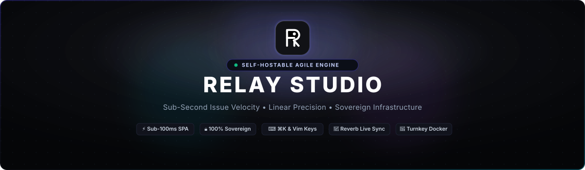
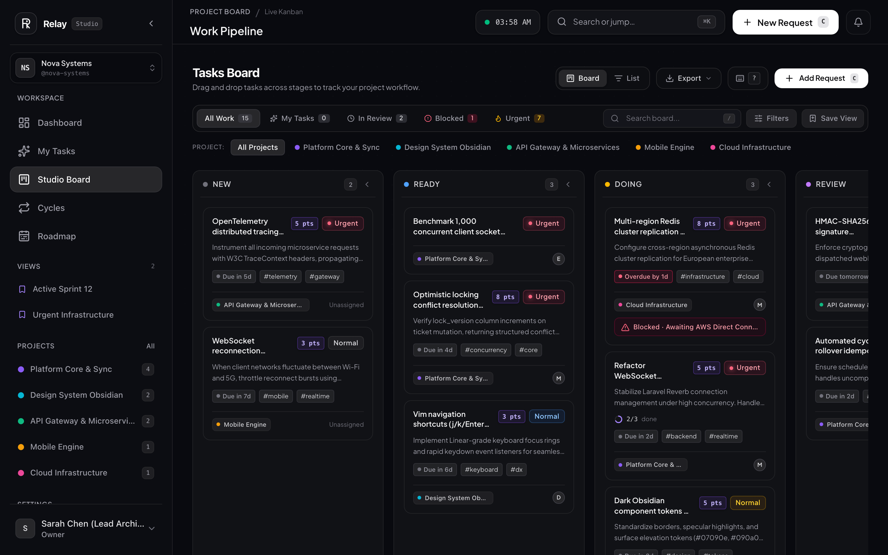
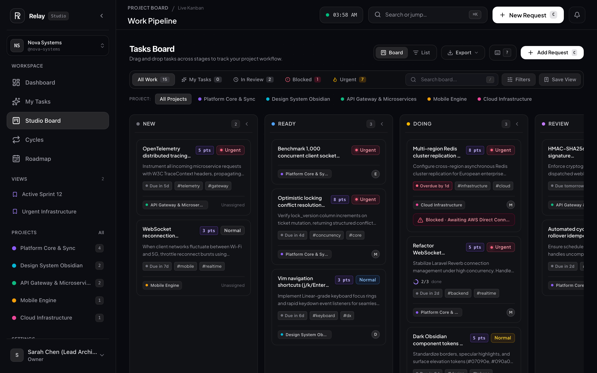
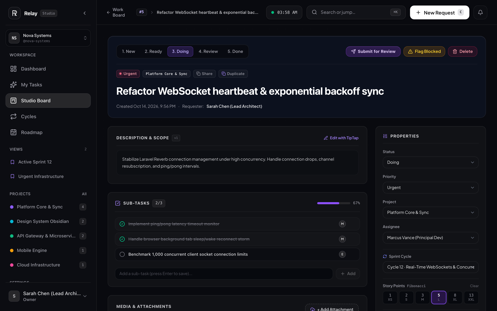
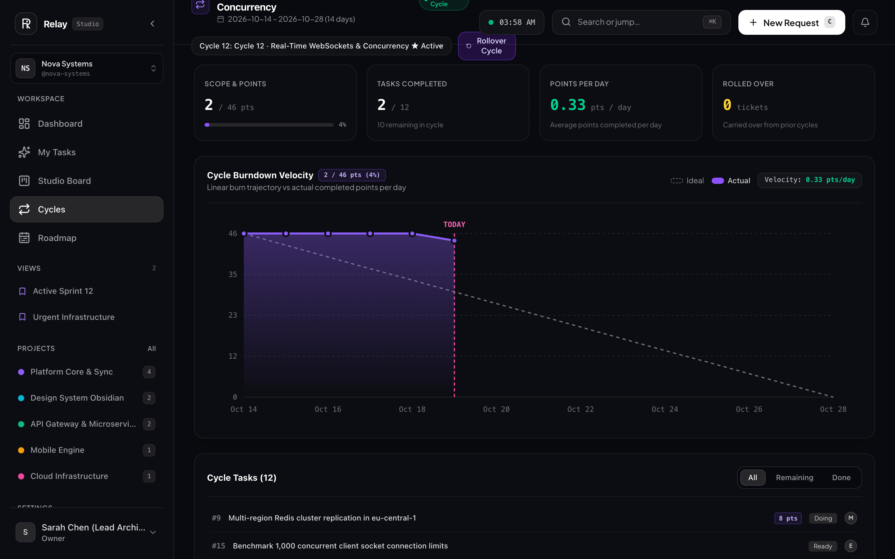
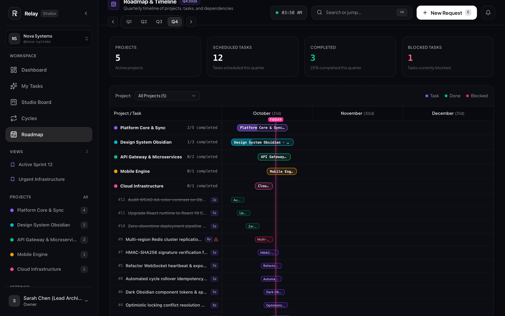
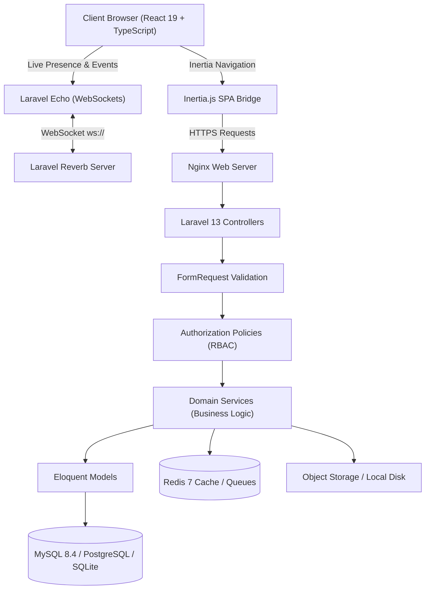

<p align="center">
  
</p>

<p align="center">
  <a href="https://opensource.org/licenses/Apache-2.0"></a>
  <a href="https://www.php.net/"></a>
  <a href="https://laravel.com/"></a>
  <a href="https://react.dev/"></a>
  <a href="https://www.typescriptlang.org/"></a>
  <a href="https://tailwindcss.com/"></a>
  <a href="https://www.docker.com/"></a>
  <a href="https://pestphp.com/"></a>
</p>

<p align="center">
  <strong>Linear-inspired ergonomics, sub-second cycle velocity, and complete data sovereignty for modern software teams.</strong>
</p>

<p align="center">
  <a href="#-overview">Overview</a> •
  <a href="#-why-relay-studio-competitive-breakdown">Competitive Breakdown</a> •
  <a href="#-core-capabilities">Capabilities</a> •
  <a href="#-interface-showcase">Interface Showcase</a> •
  <a href="#-system-architecture">Architecture</a> •
  <a href="#-quickstart-guide">Quickstart</a> •
  <a href="#-configuration-reference">Configuration</a> •
  <a href="#-artisan-cli-tools">CLI Tools</a> •
  <a href="#-rest-api-v1--webhooks">REST API &amp; Webhooks</a> •
  <a href="#-verification--quality-benchmarks">Verification</a>
</p>

---

## 🎯 Overview

**Relay Studio** is an open-source, self-hostable project management and agile issue delivery platform engineered for studios and engineering teams who refuse to compromise between **interface speed** and **data sovereignty**.

While commercial issue trackers trap engineering workflows inside proprietary clouds, enforce punitive per-seat licensing taxes, and suffer from sluggish page transitions, Relay Studio delivers:

* **Sub-Second Latency:** Inertia.js SPA hydration powered by Laravel 13 and React 19 with zero full page reloads.
* **Keyboard-First Ergonomics:** Seamless `⌘K` command launcher, quick-capture drawers, and Vim cursor navigation (`j`/`k`/`Enter`/`c`).
* **Complete Self-Hosting Control:** Zero phone-home telemetry, full multi-tenancy, and turnkey Docker orchestration with automated backup tooling.
* **Real-Time Collaboration:** Laravel Reverb WebSocket presence and live issue synchronization without third-party SaaS dependencies.

---

## 🥊 Why Relay Studio? (Competitive Breakdown)

How does Relay Studio compare against industry standards and open-source alternatives?

| Dimension | ⚡ Relay Studio | 📐 Linear | 🐘 Jira (Atlassian) | ✈️ Plane | 📋 GitHub Issues |
| :--- | :---: | :---: | :---: | :---: | :---: |
| **Hosting Model** | **100% Self-Hosted & Sovereign** | Cloud Only (SaaS) | Cloud Only (Server EOL) | Self-Hosted / Cloud | Cloud Only |
| **Per-Seat License Cost** | **$0 (Apache 2.0)** | $8 – $16 / user / mo | $8.15 – $16 / user / mo | Free tier + Paid Enterprise | Bundled in GitHub |
| **Interface Latency** | **< 100ms (Inertia SPA)** | < 100ms (SPA) | 1,200ms – 3,500ms | 300ms – 800ms | 400ms – 1,000ms |
| **Keyboard Ergonomics (⌘K / Vim)** | **Full Native Support** | Native Support | Partial / Mouse-heavy | Partial | Basic Shortcuts |
| **Real-Time Multi-User Presence** | **Native WebSocket (Reverb)** | Proprietary Sync | Polling / Slow Webhooks | WebSockets | Polling |
| **Agile Cycles & Auto-Rollover** | **Automated & Idempotent** | Native Cycles | Manual Sprints | Sprints Module | Milestones only |
| **Disaster Recovery & CLI Backups** | **Built-in (`relay:backup`)** | Cloud Export (JSON) | Paid Add-on / Manual | Docker DB Dump | Git Export |
| **Tech Stack Architecture** | **Laravel 13 + React 19** | Custom React Stack | Java / OSGi Legacy | Next.js + Django | Rails + Web Components |
| **Memory Footprint (App runtime)** | **~180 MB RAM** | N/A (Closed source) | 4 GB – 8 GB RAM min | 1.5 GB – 3 GB RAM | N/A (Closed source) |
| **Data Privacy & Telemetry** | **0 Telemetry / Air-Gappable** | Closed telemetry | Extensive Tracking | Community telemetry | Microsoft Telemetry |

---

## ⚡ Core Capabilities

### 1. Issue Triage & Delivery Pipeline (`/requests`)
* **Optimistic Kanban Board:** Smooth drag-and-drop transitions (`@hello-pangea/dnd`) across `new` (Backlog), `ready` (Ready), `doing` (In Progress), `review` (In Review), and `done` (Done).
* **Status Workflows & Validations:** Forward and backward state transitions with optimistic UI rollbacks on network failure.
* **Blocking Dependencies:** Explicit "Blocks" and "Blocked By" relationship tracking with circular dependency detection.
* **Subtasks & Hierarchical Breakdown:** Track parent tickets with real-time aggregate completion percentage bars.
* **Story Points & Estimation:** Fibonacci points sizing (`1, 2, 3, 5, 8, 13`) with aggregate sprint load forecasting.
* **Taxonomy & Tags:** Multi-label tagging, area classification, and priority assignment (`urgent`, `normal`, `low`).

### 2. Sprints, Cycles & Velocity Tracking (`/cycles`)
* **Automated Cycle Rollover:** Scheduled automated rollover (`relay:cycle-rollover`) moves incomplete issues to subsequent sprints with strict idempotency guards.
* **Burndown Analytics:** Dynamic burndown visualization powered by Recharts, tracking ideal vs. actual remaining story points.
* **Velocity Metrics:** Rolling historical velocity calculation across delivered iterations.
* **Quarterly Roadmaps (`/roadmap`):** Milestone timeline grouping tasks by target horizon and release dates.

### 3. Keyboard-First Ergonomics
* **Global Command Launcher (`⌘K` / `Ctrl+K`):** Instantly jump to any project, issue, cycle, or settings view.
* **Vim Keyboard Navigation:** Navigate lists and Kanban boards with `j` (down), `k` (up), `Enter` (open), `c` (new issue), and `Esc` (dismiss).
* **Instant Slideout Drawers:** Inspect and edit ticket attributes without losing context or leaving the board.

### 4. Real-Time Collaboration & Discussion
* **WebSocket Presence:** Powered by Laravel Reverb and Echo; see who is viewing or editing an issue simultaneously.
* **Rich Markdown Editor:** Built on TipTap with syntax highlighting, bullet/task lists, quotes, and image previews.
* **User Mentions & Instant Notifications:** In-app activity bell, chronological discussion logs, and email notifications.

### 5. Media Pipeline & Secure Storage
* **Drag-and-Drop File Uploads:** Upload screenshots, design mockups, logs, and specs.
* **WebP Image Pipeline:** Automatic image conversion and thumbnail creation for high-performance previews.
* **Secure Storage Driver:** Local disk or AWS S3 / MinIO compatible object storage.

### 6. Enterprise Security & Governance
* **Multi-Tenancy & Workspace Scoping:** Strict workspace boundary enforcement across all queries, search indices, and API controllers.
* **Granular RBAC:** Five distinct workspace roles: `Owner`, `Admin`, `Developer`, `Designer`, and `Member`.
* **Two-Factor Authentication (2FA):** Time-based One-Time Passwords (TOTP via Google Authenticator / 1Password) with emergency recovery codes.
* **Sanctum Personal Access Tokens (PAT):** Scoped REST API tokens with individual revocation (`/profile/tokens`).
* **Audit Trails:** Immutable audit logs capturing every ticket transition, assignment modification, and workspace setting update.

---

## 📸 Interface Showcase

<div align="center">
  <table>
    <tr>
      <td width="50%">
        
        <p align="center"><em>High-velocity Kanban board with optimistic status movement &amp; story points</em></p>
      </td>
      <td width="50%">
        
        <p align="center"><em>Global ⌘K command launcher and sub-second instant search</em></p>
      </td>
    </tr>
    <tr>
      <td width="50%">
        
        <p align="center"><em>Deep issue view with TipTap discussion, subtasks &amp; dependencies</em></p>
      </td>
      <td width="50%">
        
        <p align="center"><em>Sprint cycle burndown, velocity breakdown &amp; story point distribution</em></p>
      </td>
    </tr>
    <tr>
      <td colspan="2" width="100%">
        
        <p align="center"><em>Quarterly roadmap timeline tracking milestones and project delivery</em></p>
      </td>
    </tr>
  </table>
</div>

---

## 🏗️ System Architecture

Relay Studio is built following clean, testable architectural principles:



### Component Stack
* **Backend Framework:** [Laravel 13](https://laravel.com/) (PHP 8.3 / 8.4)
* **Frontend Architecture:** [React 19](https://react.dev/), [TypeScript 5.9](https://www.typescriptlang.org/), [Inertia.js 3](https://inertiajs.com/)
* **Styling System:** [Tailwind CSS 4](https://tailwindcss.com/) with Dark Obsidian palette
* **WebSocket Server:** [Laravel Reverb](https://reverb.laravel.com/)
* **Database Compatibility:** MySQL 8.4+, PostgreSQL 15+, SQLite 3
* **Cache & Queues:** Redis 7
* **Testing Engine:** Pest PHP & PHPUnit (234 passing tests)

---

## 🚀 Quickstart Guide

### Option 1: Turnkey Docker Compose (Recommended for Self-Hosters)

Get Relay Studio up and running in under 2 minutes:

```bash
# 1. Clone the repository
git clone https://github.com/Kingof3O/stm.git relay
cd relay

# 2. Boot the full container stack (App, MySQL 8.4, Redis 7, Mailpit)
docker compose up -d

# 3. Access Relay Studio in your browser
open http://localhost:8080
```

> [!NOTE]
> **Default Service Endpoints:**
> * **Relay Studio Web UI:** `http://localhost:8080`
> * **Mailpit (Email Inspector):** `http://localhost:8025`
> * **MySQL 8.4 Server:** `127.0.0.1:3306`
> * **Redis 7 Server:** `127.0.0.1:6379`

---

### Option 2: Native Local Development (macOS / Linux)

For developers using [Laravel Herd](https://herd.laravel.com/), Valet, or system PHP/Node:

```bash
# 1. Clone and install PHP dependencies
git clone https://github.com/Kingof3O/stm.git relay
cd relay
composer install

# 2. Setup environment configuration
cp .env.example .env
php artisan key:generate

# 3. Run migrations and seed essential permissions
php artisan migrate --seed

# 4. Install JavaScript dependencies & compile assets
npm install
npm run build

# 5. Start development servers
php artisan serve
npm run dev
```

---

## ⚙️ Configuration Reference

Relay Studio provides granular configuration toggles via `.env` and [`config/relay.php`](config/relay.php):

| Environment Variable | Default | Description |
| :--- | :---: | :--- |
| `RELAY_BACKUP_ENABLED` | `false` | Enable or disable automated database & file backup scheduler |
| `RELAY_BACKUP_SCHEDULE` | `0 2 * * *` | Cron interval for backups (`0 2 * * *` = daily at 02:00 UTC) |
| `RELAY_BACKUP_RETENTION_DAYS`| `14` | Automatic retention window; backups older than this are pruned |
| `RELAY_BACKUP_INCLUDE_FILES` | `false` | Include user attachments and uploaded media inside backup archives |
| `RELAY_AGILE_AUTO_ROLLOVER_ENABLED` | `true` | Automatically move incomplete issues to next cycle at sprint end |
| `RELAY_AGILE_ROLLOVER_TIME` | `00:05` | Time of day for cycle roll-forward execution |
| `RELAY_OUTGOING_WEBHOOKS_ENABLED` | `true` | Master switch for dispatching outgoing webhooks |
| `RELAY_DISCORD_ENABLED` | `true` | Dispatch Discord notifications on issue creation / cycle close |
| `RELAY_SLACK_ENABLED` | `true` | Dispatch Slack channel notifications |
| `RELAY_GITHUB_SYNC_ENABLED` | `true` | Process GitHub push webhook events to associate commits |
| `RELAY_INBOUND_EMAIL_ENABLED` | `true` | Allow issue creation via inbound email webhook endpoint |
| `RELAY_REALTIME_ENABLED` | `true` | Enable live WebSocket broadcasting and presence channels |
| `RELAY_AUDIT_ENABLED` | `true` | Capture tamper-resistant activity records into `workspace_audits` |
| `RELAY_SHOW_DEMO_CREDENTIALS` | `false` | Render demo login helpers on login page (disabled in production) |

---

## 🛠️ Artisan CLI Tools

Relay Studio provides operational Artisan CLI commands in the `relay:*` namespace:

### 1. Stack Diagnostics (`relay:doctor`)
Audit environment health, PHP extensions, database connectivity, directory permissions, and build manifests:
```bash
php artisan relay:doctor
```

### 2. Interactive Setup Wizard (`relay:install`)
Step-by-step terminal wizard to configure `.env`, generate keys, migrate schemas, and establish the initial Owner account:
```bash
php artisan relay:install
# Or unattended non-interactive mode:
php artisan relay:install --force --no-seed --admin-name="Admin" --admin-email="admin@relay.studio" --admin-password="secretpassword"
```

### 3. Automated Disaster Recovery (`relay:backup` & `relay:restore`)
Safely back up and restore database records and attachment files:
```bash
# Database only snapshot
php artisan relay:backup --only-db

# Complete snapshot including file attachments
php artisan relay:backup --include-files

# Restore from backup archive
php artisan relay:restore /path/to/relay-backup-2026-10-19.tar.gz
```

### 4. Sprint Rollover (`relay:cycle-rollover`)
Manually trigger idempotent cycle rollover:
```bash
php artisan relay:cycle-rollover
```

### 5. Integration Diagnostics (`relay:discord-test` & `relay:oauth`)
Test Discord webhooks and manage OAuth providers:
```bash
# Test Discord webhook notification
php artisan relay:discord-test

# Inspect OAuth provider status
php artisan relay:oauth
```

---

## 🔌 REST API v1 & Webhooks

Relay Studio exposes a complete REST API (v1) authenticated via **Laravel Sanctum Personal Access Tokens (PAT)**.

### Authenticating API Requests
Create a token under **Profile > API Tokens** (`/profile/tokens`), then pass it via the `Authorization` header:

```bash
curl -X GET "http://localhost:8080/api/v1/work-requests" \
     -H "Authorization: Bearer 1|abcdef1234567890..." \
     -H "Accept: application/json"
```

### REST API v1 Endpoints (`routes/api.php`)

| Method | Endpoint | Description | Query / Body Parameters |
| :--- | :--- | :--- | :--- |
| `GET` | `/api/v1/work-requests` | Paginated list of issues with filter criteria | `status`, `priority`, `area_id`, `search`, `page` |
| `POST` | `/api/v1/work-requests` | Create a new work request / issue | `title`, `description`, `status`, `priority`, `area_id`, `story_points`, `due_date`, `tags` |
| `GET` | `/api/v1/work-requests/{id}` | Retrieve complete issue details with relations, subtasks, activities & attachments | `{id}` (issue ID) |
| `PATCH` | `/api/v1/work-requests/{id}` | Update issue properties with optimistic locking | `lock_version`, `title`, `description`, `status`, `priority`, `story_points`, `due_date`, `tags` |
| `DELETE` | `/api/v1/work-requests/{id}` | Soft-delete a work request | `{id}` (issue ID) |
| `POST` | `/api/v1/work-requests/{id}/restore` | Restore a soft-deleted work request | `{id}` (issue ID) |
| `GET` | `/api/v1/projects` | List all active workspace areas / projects | — |
| `GET` | `/api/search` | Fast global search across issues & projects | `q` (search query) |

### GitHub Push Auto-Close Webhook
Link GitHub commits directly to Relay tickets:
* **Webhook Endpoint:** `POST /api/webhooks/github`
* **Commit Message Syntax:** `fixes REQ-104` or `closes #REQ-104`
* **HMAC Verification:** Automatically validates `X-Hub-Signature-256` using `GITHUB_WEBHOOK_SECRET`.

### Inbound Email Ingestion
* **Webhook Endpoint:** `POST /api/webhooks/inbound-email`
* Automatically creates formatted work requests from incoming SendGrid, Mailgun, or Postmark MIME webhooks.

---

## 🧪 Verification & Quality Benchmarks

The codebase undergoes rigorous static analysis and automated regression testing before every release:

```bash
# 1. Run automated test suite (234/234 passing)
php artisan test

# 2. Run static analysis (Level max, 0 errors across 124 files)
./vendor/bin/phpstan analyse --memory-limit=2G

# 3. Verify Laravel Pint code styling standards
./vendor/bin/pint --test

# 4. Strict TypeScript type-checking
npx tsc --noEmit

# 5. Production client and SSR bundle compilation
npm run build
```

---

## 🤝 Contributing

Contributions from the open-source community are warmly welcomed! Please read our [CONTRIBUTING.md](CONTRIBUTING.md) guide for details on coding conventions, branch management, and submitting pull requests.

---

## 🔒 Security & Vulnerability Reporting

If you discover a security vulnerability within Relay Studio, please review our [Security Policy](SECURITY.md) for responsible disclosure procedures.

---

## 📄 License

Relay Studio is open-source software licensed under the **[Apache License, Version 2.0](LICENSE)**.
