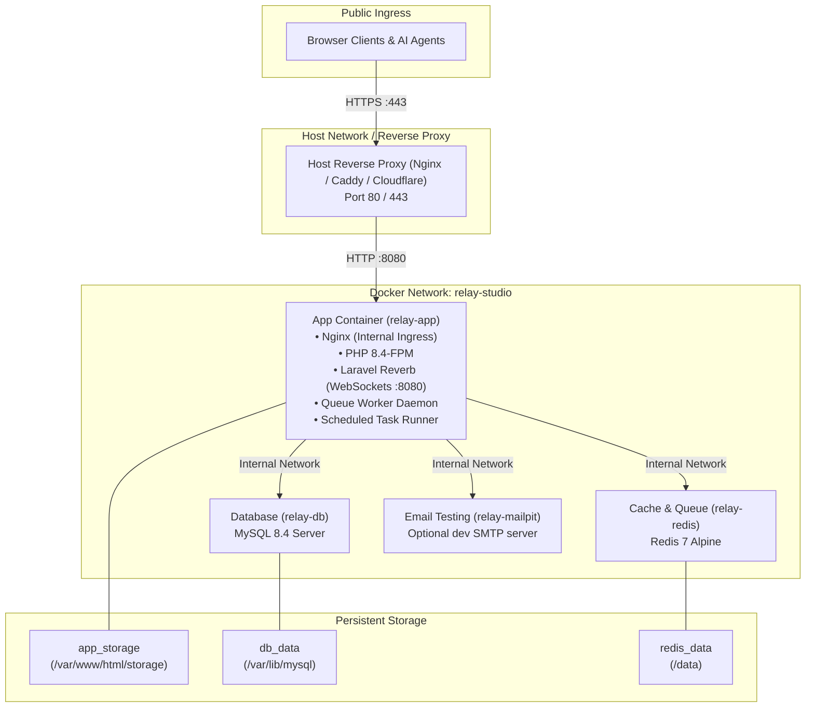

# Production Docker Guide

Relay Studio provides a production-grade, battle-tested Docker architecture designed for zero friction, high security, and minimal memory overhead.

This guide explores:
1. [Container Architecture & Topology](#1-container-architecture--topology)
2. [Volume Management & Persistence](#2-volume-management--persistence)
3. [Environment Configuration Reference](#3-environment-configuration-reference)
4. [Production SSL Termination Strategies](#4-production-ssl-termination-strategies)
   * [Strategy A: Host Nginx + Let's Encrypt Certbot (Recommended)](#strategy-a-host-nginx--lets-encrypt-certbot-recommended)
   * [Strategy B: Caddy Automatic HTTPS](#strategy-b-caddy-automatic-https)
   * [Strategy C: Cloudflare Tunnel (Zero Port Forwarding)](#strategy-c-cloudflare-tunnel-zero-port-forwarding)
5. [Operational Management & Maintenance](#5-operational-management--maintenance)
6. [Disaster Recovery & Persistent Volume Backups](#6-disaster-recovery--persistent-volume-backups)

---

## 1. Container Architecture & Topology

The standard `docker-compose.yml` orchestrates four specialized container services:



### Container Responsibilities

| Container Name | Base Image | Role & Daemons |
| :--- | :--- | :--- |
| **`relay-app`** | Custom Alpine (`Dockerfile`) | Orchestrated by Supervisord: Nginx, PHP 8.4-FPM, Laravel Reverb (WebSocket server), Queue Worker (`queue:work`), and Task Scheduler (`schedule:run`). |
| **`relay-db`** | `mysql:8.4` | Dedicated MySQL database service with automated healthchecks (`mysqladmin ping`). |
| **`relay-redis`** | `redis:7-alpine` | Low-latency in-memory data store handling cache, sessions, rate limits, and asynchronous queue dispatching. |
| **`relay-mailpit`** | `axllent/mailpit` | SMTP catch-all server and webmail client for staging or isolated deployments. In production, configure external SMTP (SendGrid, Postmark, SES). |

---

## 2. Volume Management & Persistence

All persistent state is isolated inside dedicated Docker named volumes:

```yaml
volumes:
  db_data:      # Holds MySQL transactional tables, schemas, and users
  redis_data:   # Holds Redis RDB snapshots
  app_storage:  # Holds user uploads, WebP thumbnails, avatar images, and local backups
```

### Host Mount Mapping
* `app_storage` $\rightarrow$ `/var/www/html/storage` (specifically `/app/public` uploads and `/app/backups`)
* `db_data` $\rightarrow$ `/var/lib/mysql`
* `redis_data` $\rightarrow$ `/data`

---

## 3. Environment Configuration Reference

The following variables should be declared in your root `.env` or injected via your deployment environment:

```ini
# Application Core
APP_NAME="Relay Studio"
APP_ENV=production
APP_DEBUG=false
APP_URL=https://relay.yourdomain.com
APP_KEY=base64:your_32_byte_generated_key_here

# Database Configuration
DB_CONNECTION=mysql
DB_HOST=db
DB_PORT=3306
DB_DATABASE=relay
DB_USERNAME=relay
DB_PASSWORD=your_super_strong_database_password
DB_ROOT_PASSWORD=your_root_database_password

# Redis Configuration
REDIS_HOST=redis
REDIS_PORT=6379
REDIS_PASSWORD=optional_redis_auth_password
CACHE_STORE=redis
QUEUE_CONNECTION=redis
SESSION_DRIVER=redis

# WebSocket Presence (Laravel Reverb)
BROADCAST_CONNECTION=reverb
REVERB_APP_ID=relay-studio
REVERB_APP_KEY=relay-key-live
REVERB_APP_SECRET=relay-secret-live
REVERB_HOST=0.0.0.0
REVERB_PORT=8080
REVERB_SCHEME=https

# Frontend WebSocket Connection Settings
VITE_REVERB_APP_KEY="${REVERB_APP_KEY}"
VITE_REVERB_HOST="relay.yourdomain.com"
VITE_REVERB_PORT=443
VITE_REVERB_SCHEME=https

# Email Transport (Production Example: Amazon SES / Postmark)
MAIL_MAILER=smtp
MAIL_HOST=smtp.postmarkapp.com
MAIL_PORT=587
MAIL_USERNAME=your_postmark_api_token
MAIL_PASSWORD=your_postmark_api_token
MAIL_ENCRYPTION=tls
MAIL_FROM_ADDRESS=notifications@relay.yourdomain.com
MAIL_FROM_NAME="Relay Studio"
```

---

## 4. Production SSL Termination Strategies

The `relay-app` container publishes its web server on port `8080` (or whichever port you configure for `APP_PORT`). In a production setting, you should terminate SSL/TLS at a host reverse proxy.

### Strategy A: Host Nginx + Let's Encrypt Certbot (Recommended)

Install Nginx and Certbot on your host machine:
```bash
sudo apt install -y nginx certbot python3-certbot-nginx
```

Configure `/etc/nginx/sites-available/relay`:
```nginx
map $http_upgrade $connection_upgrade {
    default upgrade;
    '' close;
}

server {
    listen 80;
    server_name relay.yourdomain.com;
    return 301 https://$host$request_uri;
}

server {
    listen 443 ssl http2;
    server_name relay.yourdomain.com;

    ssl_certificate /etc/letsencrypt/live/relay.yourdomain.com/fullchain.pem;
    ssl_certificate_key /etc/letsencrypt/live/relay.yourdomain.com/privkey.pem;
    ssl_protocols TLSv1.2 TLSv1.3;
    ssl_ciphers HIGH:!aNULL:!MD5;

    client_max_body_size 64M;

    # Standard Web Traffic & REST API
    location / {
        proxy_pass http://127.0.0.1:8080;
        proxy_set_header Host $host;
        proxy_set_header X-Real-IP $remote_addr;
        proxy_set_header X-Forwarded-For $proxy_add_x_forwarded_for;
        proxy_set_header X-Forwarded-Proto https;
        proxy_set_header X-Forwarded-Port 443;
    }

    # Laravel Reverb WebSocket Presence
    location /app {
        proxy_pass http://127.0.0.1:8080;
        proxy_http_version 1.1;
        proxy_set_header Upgrade $http_upgrade;
        proxy_set_header Connection $connection_upgrade;
        proxy_set_header Host $host;
        proxy_set_header X-Real-IP $remote_addr;
        proxy_set_header X-Forwarded-For $proxy_add_x_forwarded_for;
        proxy_set_header X-Forwarded-Proto https;
        proxy_read_timeout 86400;
        proxy_send_timeout 86400;
    }

    location /apps {
        proxy_pass http://127.0.0.1:8080;
        proxy_http_version 1.1;
        proxy_set_header Upgrade $http_upgrade;
        proxy_set_header Connection $connection_upgrade;
        proxy_set_header Host $host;
        proxy_set_header X-Real-IP $remote_addr;
        proxy_set_header X-Forwarded-For $proxy_add_x_forwarded_for;
        proxy_set_header X-Forwarded-Proto https;
        proxy_read_timeout 86400;
        proxy_send_timeout 86400;
    }
}
```

Issue your certificate:
```bash
sudo ln -s /etc/nginx/sites-available/relay /etc/nginx/sites-enabled/
sudo certbot --nginx -d relay.yourdomain.com
sudo systemctl reload nginx
```

---

### Strategy B: Caddy Automatic HTTPS

Caddy provides zero-configuration automatic Let's Encrypt or ZeroSSL certificate management with native WebSocket support:

Create a `/etc/caddy/Caddyfile`:
```caddy
relay.yourdomain.com {
    encode gzip zstd

    reverse_proxy 127.0.0.1:8080 {
        header_up X-Forwarded-Proto "https"
        header_up X-Forwarded-Port "443"
    }

    request_body {
        max_size 64MB
    }
}
```

Reload Caddy:
```bash
sudo systemctl reload caddy
```

---

### Strategy C: Cloudflare Tunnel (Zero Port Forwarding)

Cloudflare Tunnel lets you publish Relay Studio without opening any inbound ports on your firewall or VPS:

1. Install `cloudflared` on your server:
   ```bash
   curl -fsSL https://pkg.cloudflare.com/cloudflared-ascii.repo | sudo tee /etc/yum.repos.d/cloudflared.repo
   sudo apt install cloudflared
   ```
2. Authenticate and create a tunnel:
   ```bash
   cloudflared tunnel login
   cloudflared tunnel create relay-tunnel
   ```
3. Configure `~/.cloudflared/config.yml`:
   ```yaml
   tunnel: <TUNNEL_UUID>
   credentials-file: /root/.cloudflared/<TUNNEL_UUID>.json

   ingress:
     - hostname: relay.yourdomain.com
       service: http://localhost:8080
       originRequest:
         noTLSVerify: true
     - service: http_status:404
   ```
4. Route your DNS hostname to the tunnel:
   ```bash
   cloudflared tunnel route dns relay-tunnel relay.yourdomain.com
   ```
5. Run the tunnel service:
   ```bash
   sudo cloudflared service install
   sudo systemctl start cloudflared
   ```

---

## 5. Operational Management & Maintenance

### Daily Management Commands

```bash
# View aggregated real-time container logs
docker compose logs -f

# View application logs only
docker compose logs -f app

# View queue worker and scheduler output
docker compose exec app tail -f /var/www/html/storage/logs/worker.log
docker compose exec app tail -f /var/www/html/storage/logs/scheduler.log

# Check health status of all containers
docker compose ps

# Restart the application container without downtime to database
docker compose restart app
```

### Running Artisan Commands Inside Docker

Any Artisan command can be executed seamlessly inside the container using `docker compose exec`:

```bash
# Run stack diagnostics
docker compose exec app php artisan relay:doctor

# Generate an MCP Personal Access Token
docker compose exec app php artisan relay:token <username> "agent-mcp"

# Manually trigger sprint cycle rollover
docker compose exec app php artisan relay:cycle-rollover

# Clear and rebuild application caches
docker compose exec app php artisan optimize:clear
docker compose exec app php artisan optimize
```

---

## 6. Disaster Recovery & Persistent Volume Backups

### Method 1: Using the Built-In Relay Backup Engine (Recommended)
Trigger an automated, timestamped database and attachment snapshot:

```bash
# Snapshot database and attachment storage
docker compose exec app php artisan relay:backup --include-files

# Copy the backup archive from the container volume to the host
docker compose cp app:/var/www/html/storage/app/backups ./host-backups/
```

### Method 2: Host-Level Volume Snapshot
To create an offline cold-storage backup of all Docker volumes:

```bash
# Stop containers gracefully
docker compose stop

# Backup MySQL database volume
docker run --rm \
  -v relay-studio_db_data:/volume \
  -v $(pwd)/backups:/backup \
  busybox tar -czf /backup/db_data_$(date +%F).tar.gz -C /volume .

# Backup attachment storage volume
docker run --rm \
  -v relay-studio_app_storage:/volume \
  -v $(pwd)/backups:/backup \
  busybox tar -czf /backup/app_storage_$(date +%F).tar.gz -C /volume .

# Resume containers
docker compose start
```

Your persistent data, configuration secrets, and AI agent endpoints are fully isolated, reproducible, and ready for high-reliability production.
