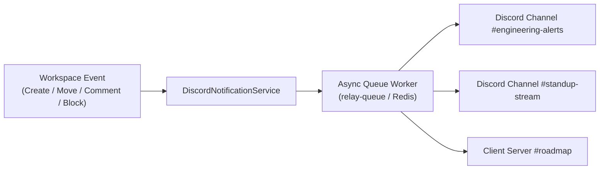

# Integrations & Notification Engine

Relay Studio includes a multi-channel notification engine that delivers real-time workspace updates to **Discord channels** and **team inboxes**.

---

## 1. Multi-Webhook Discord Integration

Relay Studio can broadcast workspace events to multiple Discord channels or separate Discord servers concurrently via incoming webhooks.

### Key Capabilities
* **Multi-Channel Dispatch:** Add any number of incoming Discord webhook URLs. Alerts are dispatched in parallel via asynchronous background queue jobs (`relay-queue`).
* **Persistent Database Storage:** Integration configuration is stored directly in the `settings` database table, ensuring webhook URLs and trigger preferences survive cache clearing (`php artisan cache:clear`, `php artisan optimize:clear`) and container restarts.
* **Granular Event Subscriptions:** Independently toggle notification triggers for different types of work.
* **Rich Embeds:** Color-coded priority indicators, status transitions, direct deep links, and author attribution.



---

## 2. Event Triggers & Kanban Movement

You can configure Discord notifications for the following events:

| Trigger | Description | Embed Color / Highlight |
| :--- | :--- | :--- |
| **🆕 Task Created** | Dispatched when any team member or AI agent creates a new work request | Violet / Project Accent |
| **⚡ Task Assigned** | Dispatched when a ticket is assigned or reassigned to a developer | Blue |
| **🔄 Status & Review** | Dispatched when a card moves across Kanban columns (`new` → `ready` → `doing` → `review` → `done`) | Green (`done`), Yellow (`review`), Blue (`doing`) |
| **🚧 Blocked Tasks** | Dispatched when a ticket is flagged as blocked, highlighting the roadblock reason | Crimson / Red |
| **💬 Comments & Mentions** | Dispatched when progress updates or `@mentions` are posted in ticket discussion | Indigo |

---

## 3. Configuring Discord via Web UI

1. In the sidebar, navigate to **Settings > Integrations** (`/integrations`).
2. Select the **Discord Webhook** tab.
3. Toggle the integration to **Enabled**.
4. In **Discord Incoming Webhook URLs**, paste your Discord webhook URL.
   * *In Discord:* Channel Settings → Integrations → Webhooks → New Webhook → Copy Webhook URL.
5. Click **Add Another Webhook** to add additional channels or servers as needed.
6. Customize the **Bot Nickname** (e.g. `Relay Studio`) and **Avatar Image URL**.
7. Select your desired **Notification Triggers**.
8. Click **Save Discord Settings**.
9. Click **Send Test Ping to Discord** to verify live delivery.

---

## 4. Testing Webhooks via Artisan CLI

You can verify your Discord webhook configuration directly from the command line:

```bash
# Test outgoing webhook delivery:
php artisan relay:discord-test

# If running under Docker Compose:
docker compose exec app php artisan relay:discord-test
```

---

## 5. Transactional Email Dispatcher

Relay Studio features a built-in transactional email system providing branded, dark-mode HTML email alerts:

* **Trigger Events:** New assignments, review requests, issue completion, blockers, and user `@mentions`.
* **Custom Brand Signatures:** Configure brand name, logo URL, organization footer, and top accent colors (Violet, Indigo, Sky Blue, Emerald, Amber, Rose).
* **Live In-App Template Previews:** Preview all notification emails directly in an interactive sandbox on `/integrations`.
* **Transport Drivers:** Compatible with standard SMTP, Mailgun, Amazon SES, Postmark, and Mailpit (local testing).
