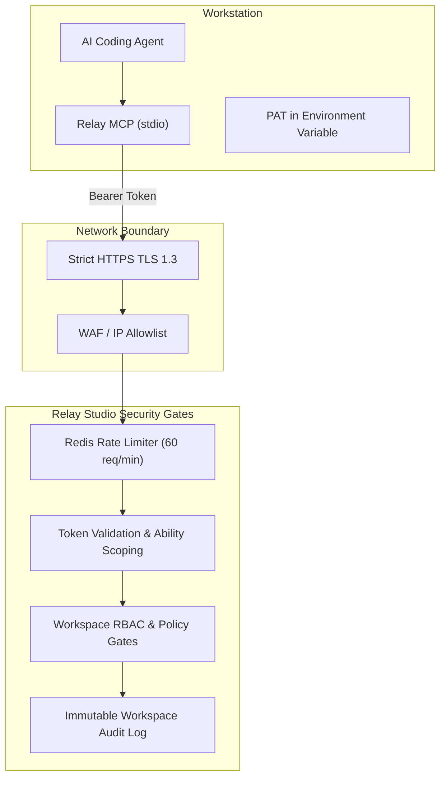

# MCP Security, Scoping & Governance Guide

When connecting autonomous AI coding agents (such as Antigravity, Cursor, Claude Desktop, or Windsurf) to your project management workspace, security boundaries and principle of least privilege must be rigorously enforced.

This guide outlines Relay Studio's security model for AI agents, covering:
1. [Threat Modeling for Autonomous Agents](#1-threat-modeling-for-autonomous-agents)
2. [Token Ability Scoping & Permissions](#2-token-ability-scoping--permissions)
3. [Token Expiration & Instant Revocation](#3-token-expiration--instant-revocation)
4. [Rate Limiting & Abuse Prevention](#4-rate-limiting--abuse-prevention)
5. [Network Hardening & Transport Security](#5-network-hardening--transport-security)
6. [Audit Trails & Action Attributability](#6-audit-trails--action-attributability)

---

## 1. Threat Modeling for Autonomous Agents

AI coding assistants process unpredictable context, external documentation, and third-party code. To protect your organization against prompt injection attacks, accidental mass modifications, and credential leakage, Relay Studio employs defense-in-depth:



---

## 2. Token Ability Scoping & Permissions

Relay Studio uses **Laravel Sanctum** to issue cryptographically signed Personal Access Tokens (PAT). Rather than granting wildcard privileges (`*`), you can generate tokens restricted strictly to required actions:

| Ability Scope | Permitted Operations | Typical Use Case |
| :--- | :--- | :--- |
| **`requests:read`** | Query tasks, inspect issue descriptions, fetch daily briefings, read cycle burndowns. Cannot modify any state. | Read-only morning catch-up agents, status dash screens, auditing tools. |
| **`requests:write`** | Create new tasks, update ticket status, edit story points, toggle blockers. | Interactive coding agents (Cursor, Antigravity) that update sprint progress as code compiles. |
| **`comments:write`** | Post technical comments and progress updates on tickets. | Continuous Integration agents reporting test outcomes or deployment diffs. |
| **`*` (Full Admin)** | All abilities granted to the issuing user's workspace role. | Primary developer agent managing full issue lifecycle. |

### Enforcing Role Boundaries
A token cannot exceed the workspace permissions of the user who generated it. If a user has the `Member` role, their MCP token cannot delete projects or modify workspace settings, even if issued with wildcard abilities.

---

## 3. Token Expiration & Instant Revocation

### Immediate Token Revocation
If an engineer leaves the organization or an AI workstation is suspected of exposure:

1. **Via Web Interface:**
   * Navigate to **Profile > Personal Access Tokens** (`/profile/tokens`).
   * Locate the agent's token and click **Revoke**. The token is invalidated immediately across all active sessions.

2. **Via Artisan CLI:**
   ```bash
   # Revoke all tokens issued to a specific user
   php artisan tinker --execute="App\Models\User::where('username', 'hussien')->first()?->tokens()->delete();"
   ```

### Automated Pruning of Expired Tokens
Relay Studio supports automatic token pruning:
```bash
php artisan sanctum:prune-expired --hours=24
```
This is scheduled automatically in production to remove inactive and stale authorization tokens.

---

## 4. Rate Limiting & Abuse Prevention

To prevent runaway agent loops from exhausting server resources or triggering API floods, all `/api/v1/*` endpoints are protected by Redis-backed sliding-window rate limiters.

### Default Thresholds
* **General API Endpoints:** 60 requests per minute per Personal Access Token.
* **Briefing & Bulk Endpoints (`/api/v1/briefing`):** 30 requests per minute.
* **Webhook Ingestion:** 120 requests per minute per IP.

When rate limits are exceeded, Relay Studio responds with HTTP `429 Too Many Requests` and standard rate limit headers:
```http
HTTP/1.1 429 Too Many Requests
Retry-After: 60
X-RateLimit-Limit: 60
X-RateLimit-Remaining: 0
X-RateLimit-Reset: 1730000000
```

### Adjusting Rate Limits
If your continuous integration pipelines or large team agent swarms require higher throughput, customize the rate limit definition in `app/Providers/AppServiceProvider.php`:

```php
RateLimiter::for('api', function (Request $request) {
    return Limit::perMinute(120)->by($request->user()?->id ?: $request->ip());
});
```

---

## 5. Network Hardening & Transport Security

1. **Enforce HTTPS / TLS 1.3:** Never expose the MCP REST API over unencrypted HTTP. All authentication tokens travel in the `Authorization: Bearer` header and must be protected by TLS.
2. **Local Stdio Transport:** The `@relay/mcp-server` runs locally on the engineer's development machine communicating via `stdio`. No listening TCP ports are opened on the developer's laptop for the MCP bridge.
3. **SSRF Guard on Outgoing Webhooks:** Relay Studio enforces strict URL sanitization on all outgoing webhook dispatches, rejecting private IP ranges (`10.0.0.0/8`, `172.16.0.0/12`, `192.168.0.0/16`), AWS metadata services (`169.254.169.254`), and loopback addresses (`127.0.0.1`).
4. **IP Restrictions (Optional):** In corporate environments, restrict access to `/api/v1/*` to your corporate VPN CIDR blocks inside your Nginx configuration.

---

## 6. Audit Trails & Action Attributability

Every mutation made via the MCP server is permanently recorded in the immutable `workspace_audits` ledger:

* **Actor Identification:** Attributed to the specific user whose PAT was used.
* **Metadata Tracked:** Timestamp, originating IP address, target entity (`WorkRequest`, `Comment`, `Cycle`), and complete `before` $\rightarrow$ `after` property diffs.
* **Tamper Resistance:** Audit entries cannot be modified or deleted through the API or UI.

To inspect recent automated agent operations:
```bash
# In your terminal:
php artisan tinker --execute="App\Models\WorkspaceAudit::latest()->take(5)->get();"
```
Or review the **Activity Log** tab on any issue or project in the web interface.
