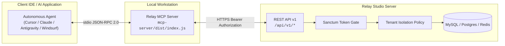

# Model Context Protocol (MCP) Integration Guide

Relay Studio includes a first-party **Model Context Protocol (MCP)** server (`@relay/mcp-server`) that bridges your self-hosted workspace with autonomous AI coding agents and LLM assistants.

Whether you use **Antigravity**, **Cursor**, **Claude Desktop**, or **Windsurf**, Relay MCP equips your AI agent with real-time read and write access to your backlog, active sprint, blocker dependencies, and discussion threads.

---

## 1. How It Works (stdio JSON-RPC Architecture)



1. **Local Agent Bridge:** Your AI client launches the Relay MCP Node.js process using standard input/output (`stdio`).
2. **REST API Transport:** The MCP server converts JSON-RPC tool calls into scoped HTTPS requests against your Relay Studio server's `/api/v1/` endpoints.
3. **Workspace Isolation:** All actions execute strictly within the authenticated user's workspace role and permissions.

---

## 2. Compiling the MCP Server

Before connecting external AI clients, build the TypeScript MCP server on your local machine or container host:

```bash
cd mcp-server
npm install
npm run build
```

This compiles `src/index.ts` into a self-contained runtime at `mcp-server/dist/index.js`.

---

## 3. Generating a Personal Access Token

Your AI agent authenticates with Relay Studio using a scoped Personal Access Token (PAT).

### Option A: Via Artisan CLI (Instant)
```bash
# On Bare-Metal VPS:
php artisan relay:token <username> "agent-mcp"

# Inside Docker Compose:
docker compose exec app php artisan relay:token <username> "agent-mcp"
```

The CLI outputs a bearer token:
```text
Personal Access Token created successfully for @hussien (Hussien):
  1|Q93LJDnnVp9aBcDeFgHiJkLmNoPqRsTuVwXyZ123456
Add this token as RELAY_API_TOKEN in your MCP client configuration.
```

### Option B: Via Web UI
1. Navigate to **Profile > Personal Access Tokens** (`/profile/tokens`).
2. Click **Create Token**.
3. Name the token (e.g., `cursor-mcp-agent`) and select appropriate ability scopes (`requests:read`, `requests:write`, or `*`).
4. Copy the generated token string.

---

## 4. Client Configuration Snippets

Copy the snippet matching your development environment. Replace `/path/to/relay` with your absolute project path, `https://relay.yourdomain.com` with your Relay server URL, and insert your `RELAY_API_TOKEN`.

### 1. Cursor IDE (`~/.cursor/mcp.json` or `.cursor/mcp.json`)

Add to `~/.cursor/mcp.json` (global) or `.cursor/mcp.json` (workspace-specific):

```json
{
  "mcpServers": {
    "relay": {
      "command": "node",
      "args": [
        "/path/to/relay/mcp-server/dist/index.js"
      ],
      "env": {
        "RELAY_URL": "https://relay.yourdomain.com",
        "RELAY_API_TOKEN": "1|your_personal_access_token_here"
      }
    }
  }
}
```

### 2. Claude Desktop (`claude_desktop_config.json`)

* **macOS:** `~/Library/Application Support/Claude/claude_desktop_config.json`
* **Windows:** `%APPDATA%\Claude\claude_desktop_config.json`
* **Linux:** `~/.config/Claude/claude_desktop_config.json`

```json
{
  "mcpServers": {
    "relay": {
      "command": "node",
      "args": [
        "/absolute/path/to/relay/mcp-server/dist/index.js"
      ],
      "env": {
        "RELAY_URL": "https://relay.yourdomain.com",
        "RELAY_API_TOKEN": "1|your_personal_access_token_here"
      }
    }
  }
}
```

### 3. Antigravity IDE (`~/.gemini/config/mcp_config.json`)

```json
{
  "mcpServers": {
    "relay": {
      "command": "node",
      "args": [
        "/absolute/path/to/relay/mcp-server/dist/index.js"
      ],
      "env": {
        "RELAY_URL": "https://relay.yourdomain.com",
        "RELAY_API_TOKEN": "1|your_personal_access_token_here"
      }
    }
  }
}
```

### 4. Windsurf IDE (`~/.codeium/windsurf/mcp_config.json`)

```json
{
  "mcpServers": {
    "relay": {
      "command": "node",
      "args": [
        "/absolute/path/to/relay/mcp-server/dist/index.js"
      ],
      "env": {
        "RELAY_URL": "https://relay.yourdomain.com",
        "RELAY_API_TOKEN": "1|your_personal_access_token_here"
      }
    }
  }
}
```

---

## 5. Complete MCP Tool Reference

| Tool Name | Arguments | Purpose & Response Schema |
| :--- | :--- | :--- |
| **`relay_get_daily_briefing`** | `since_hours` *(optional number, default: 24)* | Returns structured metrics, open blockers, tickets created overnight, active sprint end date, and unread team notifications. |
| **`relay_list_tasks`** | `status`, `priority`, `area_id`, `per_page`, `page` | Queries and filters workspace issues. Valid statuses: `new`, `ready`, `doing`, `review`, `done`. |
| **`relay_get_task`** | `id` *(required number)* | Returns full ticket details: title, description, assignee, priority, status, story points, blocking dependencies, and subtasks. |
| **`relay_update_task`** | `id` *(required)*, `status`, `priority`, `title`, `description`, `assignee_id`, `story_points`, `is_blocked`, `blocked_reason`, `due_date`, `tags` | Updates ticket properties on the board with optimistic concurrency lock verification. |
| **`relay_create_task`** | `title` *(required)*, `area_id` *(required)*, `priority`, `description`, `status`, `story_points`, `assignee_id`, `due_date`, `tags` | Creates a new task or defect under an active project or area. |
| **`relay_add_comment`** | `task_id` *(required)*, `body` *(required string)* | Posts a progress update or technical analysis. Automatically parses `@username` mentions and sends notifications. |
| **`relay_list_comments`** | `task_id` *(required)* | Retrieves the chronological discussion thread for any ticket. |
| **`relay_list_projects`** | *none* | Discovers all active workspace projects, areas, IDs, and URL slugs. |
| **`relay_get_active_cycle`** | *none* | Fetches the active sprint cycle, start/end dates, remaining days, completed story points, and task count breakdown. |

---

## 6. Real-World AI Agent Workflows

### Workflow 1: The Morning Catch-Up
**Prompt:** *"Good morning! What's our sprint status and what should I work on today?"*

The agent calls `relay_get_daily_briefing`:
```markdown
Good morning! Here is your Relay Studio briefing for today:

🚨 **Blockers & Urgent Items (1):**
• #REQ-18: Redis connection timeout under heavy job queue load

🏁 **Active Sprint (Cycle 14 — Velocity: 34 / 45 pts):**
• 3 days remaining until scheduled rollover.
• 4 tasks in Review, 2 in Doing.

📬 **Assigned to You (2):**
• #REQ-42: Implement CSRF cookie rotation on auth state change
• #REQ-55: Refactor WebP thumbnail pipeline to use libvips
```

---

### Workflow 2: Taking Ownership of a Task
**Prompt:** *"Pick up #REQ-42, move it to in progress, and assign it to me."*

The agent calls `relay_update_task`:
```json
{
  "id": 42,
  "status": "doing",
  "assignee_id": 1
}
```
And immediately responds:
> *"Ticket #REQ-42 is now assigned to you and moved to 'In Progress' on the Kanban board. I'm ready to inspect the codebase."*

---

### Workflow 3: Documenting Code Reviews & Completion
**Prompt:** *"I've finished fixing the CSRF token issue. Move #REQ-42 to review and post a comment explaining the fix."*

The agent calls `relay_add_comment`:
```json
{
  "task_id": 42,
  "body": "Implemented CSRF cookie rotation in `app/Http/Middleware/VerifyCsrfToken.php`. Added automated regression test in `tests/Feature/CsrfRotationTest.php`. All 251 tests passing."
}
```
And calls `relay_update_task`:
```json
{
  "id": 42,
  "status": "review"
}
```
