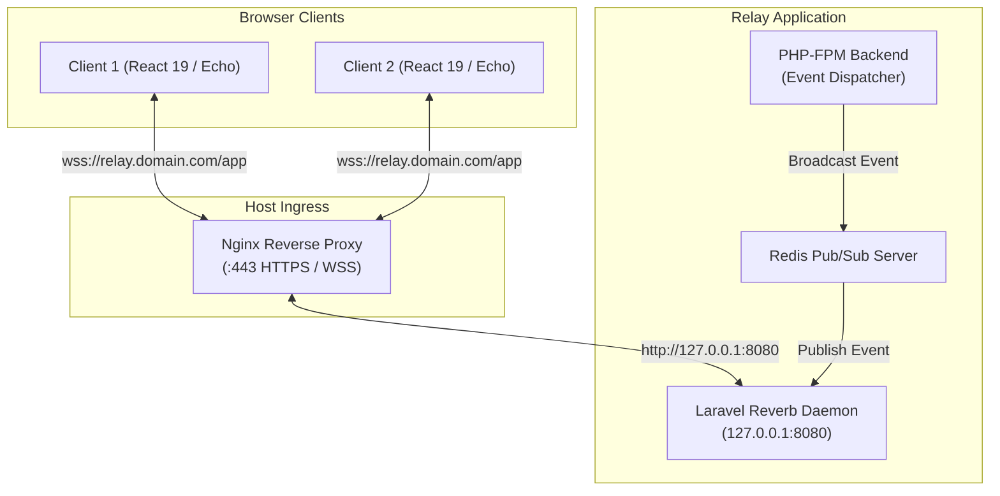

# Laravel Reverb: Real-Time WebSockets Guide

Relay Studio uses **Laravel Reverb**, a high-performance, first-party WebSocket server built directly into the PHP/Laravel ecosystem. 

Reverb eliminates reliance on external SaaS providers (like Pusher or Ably) while delivering sub-second real-time collaboration:
* **Live Presence Indicators:** See which team members are currently viewing or editing an issue.
* **Instant Kanban Board Synchronization:** Card status moves, priorities, and assignments reflect instantly across all open browser windows without manual reloading.
* **Real-Time Notification Delivery:** Unread count badges and toast notifications arrive in real time.

---

## 1. Architectural Overview



---

## 2. Configuration Parameters (`.env`)

Reverb is configured via environment variables. Ensure the server-side and client-side (Vite) keys match:

```ini
# Broadcasting Driver
BROADCAST_CONNECTION=reverb

# Backend Server Configuration
REVERB_APP_ID=relay-studio
REVERB_APP_KEY=relay-live-key
REVERB_APP_SECRET=relay-secret-random-hex
REVERB_HOST="0.0.0.0"
REVERB_PORT=8080
REVERB_SCHEME=https

# Frontend Client Configuration (Vite)
# These are baked into the compiled JavaScript bundle
VITE_REVERB_APP_KEY="${REVERB_APP_KEY}"
VITE_REVERB_HOST="relay.yourdomain.com"
VITE_REVERB_PORT=443
VITE_REVERB_SCHEME=https
```

> [!IMPORTANT]
> When `APP_ENV=production` behind an SSL reverse proxy, `VITE_REVERB_PORT` must be `443` and `VITE_REVERB_SCHEME` must be `https`. The browser establishes a secure `wss://` connection to port 443, which Nginx proxies internally to Reverb on port 8080.
> If you update `VITE_REVERB_*` variables on a bare-metal server, recompile frontend assets with `npm run build`.

---

## 3. Supervisord Daemon Configuration

In production, Reverb runs as a persistent daemon managed by Supervisord.

### Supervisord Unit (`/etc/supervisor/conf.d/relay.conf`)
```ini
[program:relay-reverb]
process_name=%(program_name)s
command=php /var/www/relay/artisan reverb:start --host=0.0.0.0 --port=8080
autostart=true
autorestart=true
user=www-data
numprocs=1
redirect_stderr=true
stdout_logfile=/var/www/relay/storage/logs/reverb.log
stdout_logfile_maxbytes=10MB
stdout_logfile_backups=3
```

### Managing the Reverb Process
```bash
# Check service status
sudo supervisorctl status relay-reverb

# Restart after configuration changes
sudo supervisorctl restart relay-reverb

# Monitor live WebSocket traffic logs
tail -f /var/www/relay/storage/logs/reverb.log
```

---

## 4. Nginx Reverse Proxy Configuration

Nginx must be configured to upgrade incoming HTTP requests to persistent WebSocket tunnels for both `/app` and `/apps` paths:

```nginx
map $http_upgrade $connection_upgrade {
    default upgrade;
    '' close;
}

server {
    listen 443 ssl http2;
    server_name relay.yourdomain.com;

    # WebSocket Proxy for Reverb
    location ~ ^/(app|apps) {
        proxy_pass http://127.0.0.1:8080;
        proxy_http_version 1.1;
        proxy_set_header Upgrade $http_upgrade;
        proxy_set_header Connection $connection_upgrade;
        proxy_set_header Host $host;
        proxy_set_header X-Real-IP $remote_addr;
        proxy_set_header X-Forwarded-For $proxy_add_x_forwarded_for;
        proxy_set_header X-Forwarded-Proto https;
        proxy_set_header X-Forwarded-Port 443;
        
        # Prevent premature timeouts on idle connections
        proxy_read_timeout 86400;
        proxy_send_timeout 86400;
        proxy_connect_timeout 60;
    }

    # Standard Laravel Application Routing
    location / {
        try_files $uri $uri/ /index.php?$query_string;
    }

    location ~ \.php$ {
        fastcgi_pass unix:/var/run/php/php8.4-fpm.sock;
        fastcgi_param SCRIPT_FILENAME $realpath_root$fastcgi_script_name;
        include fastcgi_params;
    }
}
```

---

## 5. Verifying & Troubleshooting WebSockets

### 1. Browser Inspection
1. Open your browser's Developer Tools (`F12` or `⌥⌘I`).
2. Navigate to the **Network** tab and select the **WS** (WebSockets) filter.
3. Refresh the page. You should see a persistent connection to:
   `wss://relay.yourdomain.com/app/relay-live-key?protocol=7&client=js&version=8.4...`
4. Inspect the Frames / Messages sub-tab: You will see heartbeat pings and channel subscription acknowledgments (`pusher:subscribe`, `pusher_internal:subscription_succeeded`).

### 2. Common Issues & Solutions

#### Error: `WebSocket connection to 'wss://...' failed (502 Bad Gateway)`
* **Cause:** The Reverb process is not running or crashed.
* **Fix:** Check supervisor logs:
  ```bash
  tail -n 50 /var/www/relay/storage/logs/reverb.log
  sudo supervisorctl restart relay-reverb
  ```

#### Error: `401 Unauthorized` on `/broadcasting/auth`
* **Cause:** User session cookie or CSRF token was rejected during private channel authorization.
* **Fix:** Ensure `APP_URL` in `.env` matches your browser URL exactly (including `https://`). Ensure `SESSION_DOMAIN` is either null or properly configured for your subdomain.

#### Error: Mixed Content Warning (`Connecting to ws:// on an https:// page`)
* **Cause:** `VITE_REVERB_SCHEME` is set to `http` instead of `https`.
* **Fix:** Set `VITE_REVERB_SCHEME=https` and `VITE_REVERB_PORT=443` in `.env`, then run `npm run build`.
