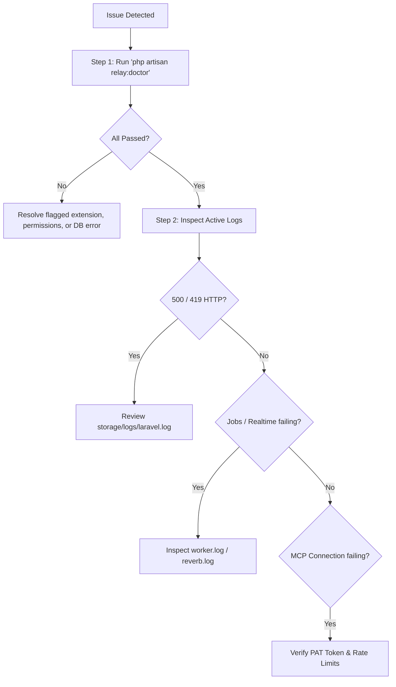

# Troubleshooting & Diagnostics Guide

When diagnosing unexpected errors, latency spikes, or failed connections in Relay Studio, follow this structured troubleshooting workflow.

---

## 1. Quick Triage Flowchart



---

## 2. Running System Diagnostics (`relay:doctor`)

Relay Studio's first line of diagnosis is the built-in doctor command:

```bash
# On Bare-Metal:
php artisan relay:doctor

# On Docker Compose:
docker compose exec app php artisan relay:doctor
```

### Interpreting Doctor Diagnostic Results

| Check Category | Failure Symptom | Corrective Action |
| :--- | :--- | :--- |
| **Runtime / PHP Version** | `FAIL: v8.1 detected` | Relay Studio requires PHP 8.3 or 8.4. Upgrade your PHP CLI and FPM runtimes. |
| **PHP Extension** | `FAIL: mbstring missing` | Install the missing PHP module (e.g. `sudo apt install php8.4-mbstring`) and restart PHP-FPM. |
| **Database** | `FAIL: Connection refused` | Verify MySQL/Postgres is running (`systemctl status mysql`) and `.env` credentials (`DB_HOST`, `DB_PASSWORD`) match. |
| **Cache & Queues** | `FAIL: Redis connection failed` | Ensure Redis is active (`systemctl status redis-server` or `redis-cli ping`). |
| **Storage Permissions** | `FAIL: Directory not writable` | Grant write permissions: `sudo chown -R www-data:www-data storage bootstrap/cache && sudo chmod -R 775 storage bootstrap/cache`. |
| **Frontend Assets** | `FAIL: manifest.json missing` | Build assets: `npm ci && npm run build`. |
| **Security** | `FAIL: APP_KEY empty` | Generate key: `php artisan key:generate`. |

---

## 3. Log File Reference & Inspection

When errors occur, inspect the relevant log file:

```bash
# 1. Main Laravel Application Exceptions & Stack Traces
tail -n 100 -f storage/logs/laravel.log

# 2. Asynchronous Queue Workers (Background jobs, emails, Discord webhooks)
tail -n 100 -f storage/logs/worker.log

# 3. Scheduled Tasks (Sprint rollover, backup retention)
tail -n 100 -f storage/logs/scheduler.log

# 4. WebSocket Presence & Live Sync (Reverb)
tail -n 100 -f storage/logs/reverb.log

# 5. Supervisord Process Master Log
tail -n 100 -f /var/log/supervisor/supervisord.log

# 6. Nginx Web Server Errors
tail -n 100 -f /var/log/nginx/error.log
```

---

## 4. Resolving Common Issues

### Issue 1: `500 Server Error` on Fresh Deployment
* **Common Cause A: Missing `APP_KEY`**
  ```bash
  php artisan key:generate
  php artisan config:cache
  ```
* **Common Cause B: Unwritable Storage Permissions**
  ```bash
  sudo chown -R www-data:www-data /var/www/relay/storage /var/www/relay/bootstrap/cache
  sudo chmod -R 775 /var/www/relay/storage /var/www/relay/bootstrap/cache
  ```

---

### Issue 2: `419 Page Expired` or CSRF Token Mismatches
* **Cause:** Browser session cookies are rejected due to URL domain mismatch or secure cookie flags on unencrypted HTTP.
* **Remedies:**
  1. Verify `APP_URL` in `.env` matches the exact URL in your browser address bar:
     ```ini
     APP_URL=https://relay.yourdomain.com
     ```
  2. If running locally without SSL during evaluation, ensure `SESSION_SECURE_COOKIE=false` in `.env`.
  3. Flush application session state:
     ```bash
     php artisan cache:clear
     ```

---

### Issue 3: Blank White Page / Missing Frontend Styling
* **Cause:** The Vite production manifest file has not been compiled or is out of sync.
* **Remedy:** Recompile front-end bundles and restart caches:
  ```bash
  npm ci
  npm run build
  php artisan optimize:clear
  php artisan optimize
  ```

---

### Issue 4: Background Emails or Webhooks Never Arrive
* **Cause:** The background queue worker process is paused, stalled, or not running.
* **Remedies:**
  1. Inspect queue backlog:
     ```bash
     php artisan queue:monitor redis:default
     ```
  2. Check for failed jobs:
     ```bash
     php artisan queue:failed
     ```
  3. Retry all failed jobs:
     ```bash
     php artisan queue:retry all
     ```
  4. Ensure supervisor queue worker is active:
     ```bash
     sudo supervisorctl status relay-worker:*
     sudo supervisorctl restart relay-worker:*
     ```

---

### Issue 5: MCP Tool Calls Return `401 Unauthorized`
* **Cause:** Invalid, expired, or malformed Personal Access Token.
* **Remedies:**
  1. Regenerate token using Artisan:
     ```bash
     php artisan relay:token <username> "agent-token"
     ```
  2. Verify your MCP client JSON (`~/.cursor/mcp.json` or `claude_desktop_config.json`) contains the exact token including the `1|` prefix.
  3. Verify the user account is active (`User::where('active', true)`).

---

### Issue 6: WebSocket Disconnections / Live Sync Stalled
* **Cause:** Reverse proxy did not pass WebSocket Upgrade headers or Reverb process died.
* **Remedies:**
  1. Review your Nginx configuration to ensure `proxy_set_header Upgrade $http_upgrade;` and `proxy_read_timeout 86400;` are configured inside `location /app`.
  2. Restart Reverb:
     ```bash
     sudo supervisorctl restart relay-reverb
     ```
  3. Check browser console for mixed-content blocks (`ws://` vs `wss://`). Ensure `VITE_REVERB_SCHEME=https` and `VITE_REVERB_PORT=443`.
