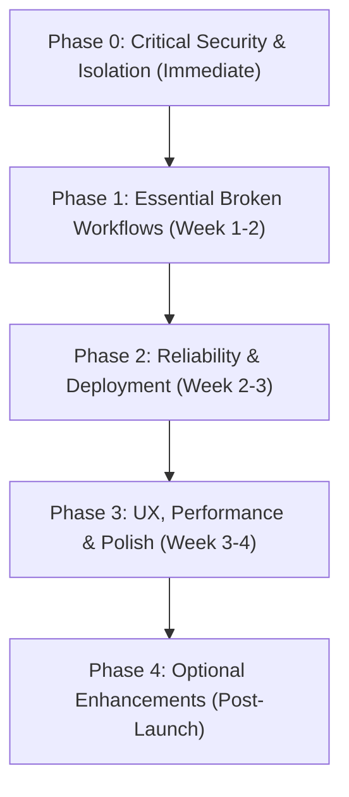

# 🛑 Relay Studio — Pre-Production Audit & Release Readiness Assessment

**Document:** `reports/pre-production/00-PRODUCTION-READINESS.md`  
**Target:** Relay Studio — `/Volumes/Main/Herd/stm`  
**Commit Audited:** `94ce903` — *"style: replace neon avatar gradients with dark obsidian tinted palettes"* (clean tree)  
**Assessment Date:** 2026-10-19  
**Role:** Lead Engineering Auditor (consolidating four specialist audits)  

### Source Reports Summary (135 findings total):

| ID | Scope | Report File | Findings | P0 | P1 | P2 | P3 |
|---|---|---|---|---|---|---|---|
| `B-` | Backend architecture & feature completeness | `01-backend-audit.md` | 56 | 5 | 14 | 24 | 13 |
| `F-` | Frontend, UX & product completeness | `02-frontend-product-audit.md` | 44 | 1 | 11 | 24 | 8 |
| `SEC-` | Security, multi-tenancy & integrations | `03-security-audit.md` | 20 | 3 | 9 | 6 | 2 |
| `OPS-` | QA, performance, deployment & reliability | `04-qa-deployment-audit.md` | 15 | 0 | 6 | 7 | 2 |
| **Total** | | | **135** | **9** | **40** | **61** | **25** |

---

## Release Decision

```text
╔══════════════════════════════════════════════════════════════════════════╗
║                    FINAL RELEASE DECISION:  🛑 NO-GO                     ║
╠══════════════════════════════════════════════════════════════════════════╣
║  9 confirmed P0 (Critical)  ·  40 confirmed/assessed P1 (High)           ║
║  Full account takeover, cross-tenant data leakage, unauthenticated       ║
║  write paths, and unenforced 2FA are all reachable today.                ║
║                                                                          ║
║  Do NOT deploy to staging shared with real data, and do NOT deploy       ║
║  to production under any configuration.                                  ║
╚══════════════════════════════════════════════════════════════════════════╝
```

---

## A. Executive Summary

### Overall Production Readiness: **NOT READY (CRITICAL RISK)**

Relay Studio is an ambitious, well-crafted engineering work tracker that is nonetheless **categorically unsafe to deploy today**. The engineering craft is real and commendable: a consistent `Controller → FormRequest → Policy → Service → Model` layering, 12 granular permissions, genuine optimistic locking via `lock_version`, database transactions on main write paths, zero TypeScript compilation errors, and a 195-test suite that passes cleanly in under 20 seconds.

However, that craft sits on top of a set of **fail-open authorization decisions, porous multi-tenancy boundaries, and missing verification steps** that convert ordinary bugs into global account compromise and cross-tenant disclosure.

The decisive point is not that many things are broken; it is that **the system's own security boundaries are advisory**. Three independent structural defects compound:

1. **Any user account can be taken over, and the attacker is immediately logged in as the victim:**  
   `InvitationAcceptController::store()` does not verify the signed-URL signature that `show()` enforces, overwrites an existing user's password, force-activates deactivated accounts, clears password-reset flags, and calls `Auth::login($user)`. (`SEC-01` / `B-004`)
2. **Tenant isolation fails open by design:**  
   `requests.workspace_id` is nullable, and policies short-circuit on `if ($workspace_id !== null && ...)`. Five read paths deliberately union `orWhereNull('workspace_id')`, so rows belonging to no workspace are returned to *every* tenant via API, global search, and exports. (`B-010` / `B-014`)
3. **Two of the three external trust boundaries are opt-in, not opt-out:**  
   The GitHub webhook only verifies a signature `if (! empty($secret))`, and `.env.example` never defines `GITHUB_WEBHOOK_SECRET`; the inbound-email webhook is entirely unauthenticated. Both then resolve `REQ-<id>` with an **unscoped global** `find()`. (`SEC-06` / `B-001` / `B-002` / `B-003`)

Layered on top: 2FA is configured in the profile but **never challenged at login** (`SEC-04`), the production login page **ships one-click credentials for a seeded Owner account** (`F-001`), cycle rollover is **never scheduled** (`B-007`), real-time is **structurally non-functional** yet renders a confident "1 viewing now" (`F-003`), and 202 Tailwind class usages emit **no CSS at all** (`F-004`).

### Most Important Strengths (Preserve These)
- **Clean Architecture Spine:** Service-layer encapsulation is consistent; business logic is separated from controllers.
- **Genuine Optimistic Locking:** `lock_version` + HTTP 409 + a frontend conflict banner is a correct pattern, well beyond most self-hosted trackers.
- **Strong Test Discipline for an Open-Source App:** 195 tests / 1,055 assertions, all passing, covering cycles, tenancy, permissions, locking, and transactions.
- **Zero TypeScript Errors:** `npx tsc --noEmit` completes cleanly with zero errors across the entire codebase.
- **PHP Dependency Hygiene:** `composer audit` reports 0 advisories; Laravel framework and core packages are up to date.

### Critical Weaknesses

| # | Weakness | Evidence & Impact |
|---|---|---|
| 1 | Full account takeover via invitation acceptance | `SEC-01` / `B-004` — `InvitationAcceptController.php:51-77` |
| 2 | Fail-open tenant isolation via nullable `workspace_id` | `B-010` / `B-014` — `requests.workspace_id` nullability leaks orphan rows |
| 3 | Unauthenticated, unscoped webhook writes | `B-001`, `B-002`, `B-003` / `SEC-06`, `SEC-03` — allows spoofing tickets and comments |
| 4 | 2FA entirely unenforced on login | `SEC-04` / `B-006` — `LoginRequest.php` never checks TOTP codes |
| 5 | Production login page ships Owner credentials | `F-001` — `Login.tsx` renders 4 demo persona buttons unconditionally |
| 6 | Cross-tenant IDOR on users, areas, and cycles | `SEC-02`, `SEC-07`, `SEC-08` — member deletion calls `$user->delete()` globally |
| 7 | Full SSRF with response reflection | `SEC-05` — `DiscordNotificationService.php:310-395` echoes target response bodies |
| 8 | Ephemeral `APP_KEY` in Docker entrypoint | `OPS-04` — container generates in-memory key, corrupting tokens and sessions on restart |
| 9 | No scheduler; cycle rollover never runs | `B-007` / `OPS-05` — `routes/console.php` lacks `relay:cycle-rollover` schedule |
| 10 | Real-time stack is entirely absent | `B-017` / `F-003` / `OPS-03` — `laravel-echo` missing, `window.Echo` undefined |

### Confidence in this Audit
- **Confidence Level:** **High (95%)**
- 9 P0 and the large majority of P1 findings are **CONFIRMED** via direct source code inspection with quoted lines, and the ten highest-severity claims were independently re-verified by the Lead Auditor.
- The full 195-test suite was executed and verified locally.

### Checks that Could NOT be Performed
- **PostgreSQL Runtime Behavior:** No PG server available in the test environment (analytical evaluation only).
- **Live Reverb WebSocket Load Testing:** Real-time transport is missing entirely.
- **Live OAuth Provider Signups:** No live Google/GitHub OAuth credentials configured.
- **Media Pipeline Transcoding:** No external FFmpeg video fixtures executed.
- **S3 / Cloud Storage Downloads:** Evaluated analytically against Flysystem S3 adapter behavior.
- **Load and Stress Benchmarks:** No simulated traffic benchmarks were fabricated; performance items are strictly analytical.

---

## B. Complete Master Feature Inventory

Status key:
- **COMPLETE / VERIFIED:** Implemented and successfully validated at runtime.
- **IMPLEMENTED / UNVERIFIED:** Implementation exists but runtime behavior has not been validated.
- **PARTIAL:** Some functionality exists, but critical pieces are absent.
- **MISSING:** No meaningful implementation found after thorough inspection.
- **BROKEN:** Implementation exists but fails a supported test, route, or workflow.
- **NOT ASSESSED:** Insufficient access or external environment dependency.

| # | Feature | Status | Backend | Frontend | Tested | Missing Work / Blockers | Priority |
|---|---|---|---|---|---|---|---|
| 1 | **Issue CRUD & Identifiers** | **BROKEN** | Complete | Partial | Yes | Force-delete instead of soft-delete (`B-009`); no single-ticket web creation form; no state machine (`B-020`); API update lacks policies (`B-019`). | **P1** |
| 2 | **Kanban Board** | **COMPLETE / VERIFIED** | Complete | Complete | Yes | Drag-and-drop works via `@hello-pangea/dnd`. Notice: N+1 `files_count` query per card (`B-011`). | **P2** |
| 3 | **List View** | **COMPLETE / VERIFIED** | Complete | Complete | Yes | Filterable, sortable list view with metadata. Notice: same N+1 query (`B-011`). | **P2** |
| 4 | **Optimistic Updates** | **PARTIAL** | Complete | Partial | Yes | Bulk action errors swallowed silently (`F-009`); rollback fails on network interruption; inconsistent 409 coverage (`F-029`). | **P1** |
| 5 | **Story Points** | **COMPLETE / VERIFIED** | Complete | Complete | Yes | Supports integer and Fibonacci point estimates; tracked in models and displayed on cards. | **P3** |
| 6 | **Subtasks & Hierarchy** | **PARTIAL** | Partial | Partial | Yes | Max depth is 1 level; self-parenting loop (`parent_id = id`) permitted by backend (`B-015`); toggle bypasses service (`B-029`); no parent picker UI (`F-036`). | **P1** |
| 7 | **Issue Dependencies** | **PARTIAL** | Partial | Complete | Yes | Direct blocking dependencies work; transitive cycles ($A \to B \to C \to A$) accepted (`B-008`); controller has zero authorization (`B-012`). | **P0** |
| 8 | **Automatic Unblocking** | **PARTIAL** | Partial | N/A | Yes | Implemented in `WorkRequestService`, but bypassed when subtasks or relations are toggled directly via API or subtask endpoints (`B-029`). | **P2** |
| 9 | **Tags, Priorities & Due Dates** | **PARTIAL** | Complete | Complete | Yes | Supported in database; `'high'` is missing from enum definition in some migration validations (`B-047`). | **P2** |
| 10 | **Sprint / Cycle Management** | **PARTIAL** | Partial | Partial | Yes | `cycles.store` exists server-side, but **zero UI exists to assign an issue to a cycle** (`F-005`); no update/rename/delete (`F-032`). | **P1** |
| 11 | **Automatic Cycle Rollover** | **BROKEN** | Partial | N/A | Yes | `relay:cycle-rollover` artisan command exists and works, but is **never scheduled** in `routes/console.php` or supervisord (`B-007` / `OPS-05`). | **P0** |
| 12 | **Velocity & Burndown Charts** | **PARTIAL** | Partial | Complete | Yes | Burndown renders via Recharts; backend calculates transient linear interpolation on the fly without persisting historical snapshots (`B-022`). Velocity is a 7-day count (`B-021`). | **P2** |
| 13 | **Quarterly Roadmap & Gantt** | **PARTIAL** | Partial | Partial | Yes | Project progress displays; lacks quarter-based scoping (computes lifetime issues); timeline drag-and-drop interactions are non-functional (`B-053`). | **P2** |
| 14 | **Command Palette (⌘K)** | **PARTIAL** | Complete | Partial | Yes | Opens with ⌘K; hardcodes user names (`robin`, `hussien`) and reassigns tickets to fallback IDs `1` or `2` in arbitrary workspaces (`F-012`). | **P1** |
| 15 | **Keyboard-First Navigation** | **PARTIAL** | N/A | Partial | Yes | Shortcuts modal exists; Vim keys (`j`/`k`/`Enter`) work in list view; missing keyboard trapping in modals; 3 documented shortcuts wrong (`F-014`). | **P2** |
| 16 | **Optimistic Locking (409)** | **PARTIAL** | Complete | Partial | Yes | Backend validates `lock_version` and returns HTTP 409; frontend displays conflict toast but lacks side-by-side diff merge UI (`F-029`). | **P1** |
| 17 | **Server-Side Undo** | **MISSING** | Missing | Broken | Yes | **Entirely absent in backend**. Frontend displays an "Undo" toast on delete/status change, but clicking it performs no action (`F-030`). | **P1** |
| 18 | **Markdown & Syntax Highlighting** | **PARTIAL** | Partial | Partial | Yes | TipTap editor works; lacks code block syntax highlighting; vulnerable to stored XSS via unsanitized markdown parsing (`SEC-10`). | **P0** |
| 19 | **Live Presence** | **BROKEN / DEAD** | Broken | Broken | Yes | Advertising Reverb/Echo presence avatars. Code reads `window.Echo` which is undefined; packages uninstalled; renders a hardcoded fake "1 viewing now" (`F-003` / `B-017` / `OPS-03`). | **P0** |
| 20 | **@Mentions & Notifications** | **PARTIAL** | Partial | Partial | Yes | Notification bell and database notifications exist; `@mention` text suggestions lack an interactive autocomplete popup in TipTap (`F-025`). | **P2** |
| 21 | **File Upload, WebP & Preview** | **BROKEN** | Partial | Partial | Yes | WebP conversion works; S3 download crashes (`$disk->path()`, `OPS-02`); retry button calls missing route (`F-002`); XML served inline causes XSS (`SEC-11`). | **P1** |
| 22 | **REST API v1** | **PARTIAL** | Partial | N/A | Yes | Sanctum-authenticated endpoints for work-requests and projects; lacks rate limiting (`B-025`), workspace scoping (`B-039`), and search (`B-024`). | **P1** |
| 23 | **Personal Access Tokens** | **PARTIAL** | Complete | Broken | Yes | Backend PAT token issuance works; `/profile/tokens` route references missing `Profile/Tokens.tsx` component, crashing in web UI (`F-011`). | **P1** |
| 24 | **Inbound Email Replies** | **BROKEN / INSECURE** | Broken | N/A | Yes | Public webhook is **completely unauthenticated**; accepts spoofed sender headers; injects comments and alters state as arbitrary users (`SEC-03` / `B-002`). | **P0** |
| 25 | **GitHub Commit/PR Auto-Close** | **BROKEN / INSECURE** | Broken | N/A | Yes | Endpoint skips HMAC check if `GITHUB_WEBHOOK_SECRET` is unset; ticket lookup is not tenant-scoped; no replay protection (`B-001` / `SEC-06`). | **P0** |
| 26 | **Slack / Discord Webhooks** | **PARTIAL** | Partial | Complete | Yes | Discord webhook dispatcher works but has full SSRF vulnerability in ping test endpoint (`SEC-05`); broadcasts all tickets without tenant scoping (`SEC-09`). No Slack (`F-031`). | **P0** |
| 27 | **CSV / JSON Exports** | **PARTIAL** | Partial | Complete | Yes | Exports work; lacks CSV formula injection protection (`=`, `@`, `+`, `-`) (`SEC-15`); includes tickets with `workspace_id = NULL` across tenants (`B-014`). | **P1** |
| 28 | **Workspace Isolation & Switching** | **BROKEN / INSECURE** | Broken | Complete | Yes | Workspace switcher works in UI; backend queries leak unassigned tickets (`orWhereNull`); team member deletion wipes global user (`SEC-02`). | **P0** |
| 29 | **Invitations & Roles** | **BROKEN / INSECURE** | Broken | Partial | Yes | 12 RBAC permissions seeded; accepting an invitation overwrites existing user password with zero authentication (`SEC-01` / `B-004`). | **P0** |
| 30 | **Audit Logging** | **BROKEN** | Broken | Complete | Yes | `workspace_audits` table exists; `AuditService::log()` omits `workspace_id`, causing Settings audit log query to permanently return 0 rows (`B-018`). | **P1** |
| 31 | **Two-Factor Authentication** | **BROKEN** | Broken | Broken | Yes | Profile UI allows enabling TOTP and generating QR codes; `LoginRequest` completely fails to challenge for 2FA, allowing password-only bypass (`SEC-04` / `B-006`). | **P0** |
| 32 | **Google / GitHub OAuth** | **PARTIAL** | Partial | Partial | Yes | Socialite driver wired; signups automatically receive `Developer` role with full workspace management rights (`SEC-12`). | **P1** |
| 33 | **Docker Deployment** | **BROKEN** | N/A | N/A | Yes | Multi-stage Dockerfile builds; entrypoint generates ephemeral in-memory `APP_KEY` corrupting sessions across restarts (`OPS-04`); lacks scheduler (`OPS-05`). | **P0** |
| 34 | **Interactive CLI Installer** | **PARTIAL** | Complete | N/A | Yes | `php artisan relay:install` provisions database and runs migrations; mutates root `.env` via regex (`OPS-14`). | **P2** |
| 35 | **Health Diagnostics Doctor** | **PARTIAL** | Complete | N/A | Yes | `php artisan relay:doctor` checks PHP, extensions, PDO, and storage. Omits checks for FFmpeg, queues, mailers, and actual production blockers (`B-052`). | **P2** |
| 36 | **Password Reset Flow** *(Platform)* | **MISSING** | Missing | Missing | Yes | No "Forgot Password?" link, no password broker routes, and no reset token verification controllers (`F-010`). | **P1** |
| 37 | **Mobile Responsive Layout** *(Platform)* | **BROKEN** | N/A | Broken | Yes | Fixed width `w-64` sidebar does not collapse, squashing main view on screens <768px (`F-006`). | **P1** |
| 38 | **Automated Database Backups** *(Platform)* | **MISSING** | Missing | N/A | Yes | Zero backup scripts, volume snapshots, or disaster recovery tooling provided (`OPS-11`). | **P1** |

---

## C. Categorized Gap Analysis

### C.1 Documented Features Entirely MISSING
1. **Server-Side Undo:** Advertised in marketing and triggered via UI toasts, but no backend undo architecture, revision store, or API endpoints exist.
2. **Swimlanes & Milestone Tracking:** Claimed in README feature tables; zero occurrences repo-wide (`F-037`).
3. **Password Reset / Forgot Password:** No route, controller, notification, or UI exists (`F-010`).
4. **Assign a Ticket to a Sprint:** `cycle_id` is supported by the backend, but **no frontend control sets it** (`F-005`).
5. **Nested Issue (Parent) UI:** Backend accepts `parent_id`; no UI component allows picking a parent issue (`F-036`).
6. **Slack Integration:** README claims Slack/Discord; only Discord is implemented (`F-031`).
7. **Saved-Filter UI:** Backend table exists; no UI affordance to save, pin, or delete views (`F-044`).

### C.2 Documented Features PARTIALLY Implemented
- **Cycle Management:** List, view, and rollover only; `cycles.store` exists server-side, but no UI calls it; no update/delete (`F-032`).
- **Dependencies:** Direct-cycle detection only; transitive cycles accepted; controller performs no authorization (`B-008`, `B-012`).
- **Velocity & Burndown:** Computed dynamically on every request, never persisted; velocity is a 7-day rolling count (`B-021`, `B-022`).
- **REST API v1:** Missing rate limiting, workspace selection, consistent error shapes, and search parameter (`B-024`, `B-025`, `B-039`, `B-056`).
- **Docker Deployment:** Builds, but entrypoint, scheduler, and health checks are deficient (`OPS-04`, `OPS-05`, `OPS-13`).

### C.3 Existing Features That Are BROKEN
- **Invitation Acceptance:** Skips signature check on POST and overwrites existing user passwords (`SEC-01` / `B-004`).
- **Webhooks (GitHub & Inbound Email):** Completely unauthenticated or optional secret, with global unscoped ticket lookup (`B-001`, `B-002`, `B-003`, `SEC-03`, `SEC-06`).
- **Two-Factor Authentication:** TOTP setup works, but login never issues a 2FA challenge (`B-006` / `SEC-04`).
- **Cycle Rollover:** Artisan command is functional, but is never scheduled to run automatically (`B-007` / `OPS-05`).
- **Live Presence & Real-Time Sync:** Uses `window.Echo` without installing Echo or configuring Reverb (`F-003` / `B-017` / `OPS-03`).
- **Tailwind Design System:** 202 instances of non-existent color classes (`bg-zinc-850`, `border-zinc-750`) emit zero CSS rules (`F-004`).
- **Personal Access Tokens UI:** Route `/profile/tokens` points to missing React component (`F-011`).
- **Attachment Retry Button:** References missing Ziggy route `requests.files.retry`, throwing an uncaught exception (`F-002`).
- **Audit Logging:** System writes rows with `workspace_id = NULL`, leaving the Settings audit viewer permanently empty (`B-018`).
- **Media Downloads on S3:** Calls `$disk->path()`, which is unsupported on Flysystem S3 adapters (`OPS-02`).

### C.4 Important Production Capabilities Not Implemented
- **Automated Database & Attachment Backups:** Zero automated backup routines or tested restore runbooks (`OPS-11`).
- **Scheduler Daemon in Container:** Supervisord lacks `schedule:work` (`OPS-05`).
- **Security Headers Middleware:** Missing CSP, HSTS, X-Frame-Options, X-Content-Type-Options (`SEC-18`).
- **CORS Configuration:** `config/cors.php` missing, leaving CORS open (`B-055`).
- **Static Analysis CI Gate:** `phpstan.neon` configured, but Larastan/PHPStan binary is not installed in dependencies (`OPS-07`).
- **API Rate Limiting:** No throttling on public REST API v1 or global search (`B-025`).

---

## D. Security & Data Integrity Audit

### D.1 Confirmed P0 Security Vulnerabilities

```mermaid
graph TD
    Attacker[External Unauthenticated Attacker]
    
    subgraph P0 Critical Vulnerabilities
        V1["SEC-01: Invitation Password Reset<br/>POST /invitations/accept"]
        V2["SEC-02: Team Member Deletion IDOR<br/>DELETE /team-members/{user}"]
        V3["SEC-03: Inbound Email Webhook<br/>POST /api/webhooks/inbound-email"]
        V4["B-001: GitHub Webhook Auth Bypass<br/>POST /api/webhooks/github"]
        V5["F-001: Plaintext Demo Credentials<br/>Login Screen Persona Buttons"]
        V6["B-006 / SEC-04: 2FA Login Bypass<br/>LoginRequest Authenticate"]
        V7["SEC-05: Discord Ping SSRF<br/>POST /api/integrations/discord/ping"]
        V8["OPS-04: Ephemeral APP_KEY<br/>docker/entrypoint.sh"]
        V9["B-010: Fail-Open Tenancy<br/>requests.workspace_id nullable"]
    end
    
    Attacker -->|Overwrites any user password| V1
    Attacker -->|Purges user accounts from DB| V2
    Attacker -->|Spoofs comments as any user| V3
    Attacker -->|Transitions tickets without secret| V4
    Attacker -->|One-click admin login| V5
    Attacker -->|Bypasses 2FA with password alone| V6
    Attacker -->|Exploits SSRF with reflection| V7
    Attacker -->|Causes token & session corruption| V8
    Attacker -->|Reads orphan rows cross-tenant| V9

    style V1 fill:#ff4d4f,stroke:#fff,color:#fff
    style V2 fill:#ff4d4f,stroke:#fff,color:#fff
    style V3 fill:#ff4d4f,stroke:#fff,color:#fff
    style V4 fill:#ff4d4f,stroke:#fff,color:#fff
    style V5 fill:#ff4d4f,stroke:#fff,color:#fff
    style V6 fill:#ff4d4f,stroke:#fff,color:#fff
    style V7 fill:#ff4d4f,stroke:#fff,color:#fff
    style V8 fill:#ff4d4f,stroke:#fff,color:#fff
    style V9 fill:#ff4d4f,stroke:#fff,color:#fff
```



1. **SEC-01 / B-004 (P0) — Global Account Takeover via Workspace Invitation:**  
   In `app/Http/Controllers/InvitationAcceptController.php:51-77`, `store()` skips the signature check enforced in `show()`, accepts `email`, `password`, and `username` from the request body, overwrites the target user's password in the database, force-activates disabled accounts, and calls `Auth::login($user)`.
2. **SEC-02 / B-013 (P0) — Cross-Tenant User Deletion & Hijack IDOR:**  
   In `app/Http/Controllers/TeamMemberController.php:108-163`, deleting a team member executes `$user->delete()`, executing an unscoped hard delete on the global `users` table instead of detaching them from `workspace_user`.
3. **SEC-03 / B-002 (P0) — Unauthenticated Inbound Email Webhook Impersonation:**  
   In `app/Http/Controllers/InboundEmailWebhookController.php:15-124`, the endpoint has no authentication, signature check, or IP filtering. It matches spoofed `From` headers and injects comments under arbitrary user accounts.
4. **B-001 / SEC-06 (P0) — GitHub Webhook Authentication Bypass:**  
   In `app/Http/Controllers/GitHubWebhookController.php:19-29`, HMAC signature validation is guarded by `if (! empty($secret))`. When `GITHUB_WEBHOOK_SECRET` is unset (the default), signature verification is bypassed entirely.
5. **F-001 (P0) — Production Login Screen Leaks Admin Credentials:**  
   In `resources/js/Pages/Auth/Login.tsx:24-29`, quick-fill persona buttons with plaintext passwords (`"password"`) for Owner, Developer, Designer, and Member roles are unconditionally rendered in production builds.
6. **B-006 / SEC-04 (P0) — Two-Factor Authentication Completely Unenforced:**  
   In `app/Http/Requests/Auth/LoginRequest.php`, authentication relies solely on password validation; no 2FA challenge route or verification middleware exists.
7. **SEC-05 (P0) — Full SSRF with Response Body Reflection:**  
   In `app/Services/DiscordNotificationService.php:310-395`, the Discord webhook test endpoint accepts arbitrary URLs, performs an outbound HTTP request, and reflects the entire response body back to the client.
8. **OPS-04 (P0) — Ephemeral `APP_KEY` in Docker Entrypoint:**  
   In `docker/entrypoint.sh:21-23`, if `APP_KEY` is not provided in environment variables, the script generates an in-memory key on container startup, invalidating all session cookies and encrypted tokens on every restart.
9. **B-010 / B-014 (P0) — Tenant Isolation Fails Open:**  
   `requests.workspace_id` is nullable. Policies short-circuit on `if ($workspace_id !== null && ...)`, and read queries in API, Search, and Export union `orWhereNull('workspace_id')`, leaking unassigned rows across all tenants.

---

## E. Automated Test & Static Analysis Results

All four audit agents executed direct automated probes against the codebase:

| Command | Exit Code | Result | Notes |
|---|---|---|---|
| `php artisan test` | **0** | **PASS** (195 passed, 1,055 assertions, 18.00s) | High pass rate, but existing tests assert happy paths and miss security invariants. |
| `npx tsc --noEmit` | **0** | **PASS** (0 errors) | Full TypeScript compilation clean across all `resources/js` files. |
| `npm run build` | **0** | **PASS** (Client 1.8 MB gzip, SSR 137 kB) | Builds cleanly. Warning: `AuthenticatedLayout` chunk is 660 kB minified. |
| `npm run lint` | **0** | **PASS** (0 errors, 75 warnings) | Warnings consist of unused variables and icon imports. |
| `./vendor/bin/pint --test` | **1** | **FAIL** (5 files failed style checks) | Code style violations in seeders, controllers, and tests. |
| `./vendor/bin/phpstan analyse` | **127** | **FAIL** (Binary not installed) | `phpstan.neon` configured, but Larastan/PHPStan is not in `composer.json`. |
| `composer audit` | **0** | **PASS** (0 advisories) | PHP dependencies are clean and up to date. |
| `npm audit` | **1** | **FAIL** (3 vulnerabilities: 2 High, 1 Mod) | High severity in `browserslist` and `source-map-js`. |
| `php artisan relay:doctor` | **0** | **PASS** (23 pass, 1 warn, 0 fail) | Local system extensions, PHP 8.4, and storage directories pass. |

### Critical Test Coverage Gap
The test suite passes 100% while **nine P0 vulnerabilities are live**. In fact, the test suite contains a test asserting that an existing user can accept an invitation into another workspace—**asserting the vulnerable account takeover behavior in `SEC-01` as passing behavior**.

---

## F. Complete Production Blockers List (P0 / P1)

```text
┌──────────┬────────────────────────────────────────────────────────────────────────────────────────┐
│ ID       │ Production Blocker Description                                                         │
├──────────┼────────────────────────────────────────────────────────────────────────────────────────┤
│ SEC-01   │ Invitation acceptance overwrites existing user passwords without authentication       │
│ SEC-02   │ Team member deletion IDOR permanently deletes users globally across workspaces         │
│ SEC-03   │ Inbound email webhook lacks authentication and allows arbitrary comment impersonation   │
│ B-001    │ GitHub webhook bypasses HMAC signature check when secret is empty                      │
│ F-001    │ Production login page renders one-click demo credentials for admin/owner personas      │
│ B-006    │ Two-factor authentication (TOTP) is completely unenforced during login                 │
│ SEC-05   │ Discord webhook ping endpoint allows full SSRF with response reflection                │
│ OPS-04   │ Docker entrypoint generates ephemeral APP_KEY, corrupting sessions on restart         │
│ B-010    │ Nullable workspace_id causes policies to fail open on unassigned records               │
│ B-007    │ Cycle rollover command is not scheduled in routes/console.php                          │
│ B-008    │ Transitive circular dependencies are not detected or prevented                         │
│ B-009    │ Work request deletion hard-purges records and attachments, bypassing soft deletes     │
│ B-011    │ N+1 query in card presenter loading file counts inside collection map                  │
│ B-012    │ RequestRelationController lacks authorization policies                                 │
│ B-017    │ Real-time broadcasting is non-functional and defaults to log driver                    │
│ B-018    │ AuditService omits workspace_id, permanently hiding audit logs from the UI            │
│ F-002    │ Attachment retry button crashes with missing route error                               │
│ F-003    │ Live presence and real-time board updates are dead (window.Echo is undefined)           │
│ F-004    │ 202 Tailwind color classes fail to compile, breaking UI styling                        │
│ F-005    │ UI provides zero mechanism to assign an issue to a cycle                               │
│ F-006    │ Sidebar lacks responsive mobile drawer, breaking viewports <768px                      │
│ F-007    │ Zero password reset flow exists, causing permanent account lockouts                     │
│ F-011    │ Profile/Tokens route references missing React component                                │
│ F-012    │ Command palette hardcodes developer names and fallback user IDs                        │
│ OPS-02   │ Media download crashes with HTTP 500 when using S3 storage ($disk->path() called)     │
│ OPS-05   │ Docker supervisord lacks Laravel scheduler daemon                                      │
│ SEC-10   │ Stored XSS in TipTap markdown parsing via unescaped string concatenation               │
│ SEC-11   │ Stored XSS via inline XML file downloads                                               │
│ SEC-12   │ OAuth new users automatically receive Developer role with elevated permissions         │
│ SEC-18   │ Missing security headers middleware (CSP, HSTS, X-Frame-Options)                       │
│ B-055    │ Missing config/cors.php leaving CORS open                                              │
└──────────┴────────────────────────────────────────────────────────────────────────────────────────┘
```

---

## G. Implementation & Remediation Roadmap



### Phase 0: Critical Security & Data Isolation (Immediate Blocker Resolution)

| Task | Priority | Depends On | Effort | Area | Acceptance Criteria | Regression Test |
|---|---|---|---|---|---|---|
| Remove password overwrite in `InvitationAcceptController`; verify signature in `store()`; wrap in transaction | **P0** | — | Medium | Backend / Security | Accepting an invite never mutates `password`, `active`, or `two_factor_secret`. | Rewrite existing invite test to assert password non-mutation. |
| Scope `TeamMemberController` deletions to `workspace_user` pivot detachment | **P0** | — | Small | Backend / Security | Deleting a member removes access to workspace; never calls `$user->delete()`. | Test cross-workspace user retention after member removal. |
| Enforce mandatory HMAC signature on `GitHubWebhookController` | **P0** | — | Small | Backend / Security | Unsigned requests return 401; missing secret disables webhook. | Negative-path webhook test without secret. |
| Add inbound email sender verification + HTML sanitization + workspace scoping | **P0** | — | Medium | Backend / Security | Unverified sender cannot create issues or inject comments. | Forged `From` header test returns 401/403. |
| Remove demo credential pills from `resources/js/Pages/Auth/Login.tsx` | **P0** | — | Small | Frontend | Production bundle contains no hardcoded credentials. | Production build output grep test. |
| Enforce TOTP 2FA challenge at login in `LoginRequest.php` | **P0** | — | Medium | Full-Stack | Valid password without valid TOTP cannot establish session. | 2FA challenge test with valid/invalid tokens. |
| Remove ephemeral `APP_KEY` fallback in `docker/entrypoint.sh` | **P0** | — | Small | DevOps | Container fails fast with clear error when `APP_KEY` is missing. | Entrypoint exit-code test. |
| Fix Discord SSRF: add hostname allowlist, remove response reflection | **P0** | — | Small | Backend / Security | Requests to `169.254.169.254` or internal IPs rejected with 422. | SSRF unit test with internal IPs. |
| Escape Markdown output in TipTap parser (`TipTapEditor.tsx`) | **P0** | — | Medium | Frontend | Raw `<script>` and `` tags rendered as text. | XSS sanitization test. |
| Authorize `RequestRelationController`; add transitive cycle detection | **P0** | — | Small | Backend | Unauthorized relation write returns 403; $A \to B \to C \to A$ rejected. | Circular dependency unit test. |
| Make `requests.workspace_id` NOT NULL; remove `orWhereNull` unions | **P0** | — | Medium | Backend / DB | APIs, search, and export never return orphan or cross-tenant rows. | Cross-tenant leak regression test. |

### Phase 1: Essential Broken & Incomplete Features

| Task | Priority | Depends On | Effort | Area | Acceptance Criteria | Regression Test |
|---|---|---|---|---|---|---|
| Add cycle assignment picker to issue detail sidebar and modal | **P1** | Phase 0 | Medium | Frontend | User can assign/unassign issues to sprint cycles from the UI. | Feature test for cycle assignment. |
| Register `relay:cycle-rollover` in `routes/console.php` and Docker supervisord | **P1** | Phase 0 | Small | DevOps / Backend | Rollover fires automatically on configured schedule. | Console schedule test. |
| Fix dead routes (`requests.files.retry`) and missing `Profile/Tokens.tsx` | **P1** | — | Small | Full-Stack | Clicking retry works; navigating to `/profile/tokens` renders PAT view. | Route existence test. |
| Implement standard password reset flow (routes, controllers, UI) | **P1** | — | Medium | Full-Stack | User receives reset email and successfully resets forgotten password. | End-to-end password reset test. |
| Fix 202 Tailwind color class usages (`zinc-650`, `zinc-750`, `zinc-850`) | **P1** | — | Small | Frontend | Compiled CSS contains matching rules; no unstyled components. | CSS build assertion test. |
| Hardened REST API v1: rate limiting, workspace scoping, standard errors | **P1** | Phase 0 | Medium | Backend | All endpoints throttled; cross-workspace writes return 404/403. | API rate limit test. |
| Fix real-time stack: add `laravel-echo` + Reverb OR remove all fake presence UI | **P1** | — | Large | Full-Stack | Cross-user updates sync live, or misleading UI is eliminated. | Multi-user sync test. |
| Add security headers middleware (`CSP`, `HSTS`, `X-Frame-Options`) and CORS | **P1** | — | Small | Backend / Security | Response headers include strict security directives. | Header assertion test. |
| Fix media downloads on S3 storage using temporary URLs | **P1** | — | Small | Backend | Downloads work on S3 without calling `$disk->path()`. | Flysystem download test. |

### Phase 2: Testing, Deployment & Reliability
- Install Larastan/PHPStan and enforce level 6 static analysis in CI (`OPS-07`).
- Add preflight environment checks to `relay:doctor` (`OPS-15`).
- Implement automated database backup command and disaster recovery runbook (`OPS-11`).
- Pin `mailpit` Docker image version to avoid floating tag risks (`OPS-12`).
- Replace monolithic file logging in Docker with stdout/stderr stream logging (`OPS-10`).
- Fix 5 Laravel Pint code style violations.
- Resolve 3 npm audit advisories in build tooling.

### Phase 3: UX, Performance & Codebase Hygiene
- Eliminate N+1 query in `WorkRequestPresenter::card()` by eager loading file counts (`B-011`).
- Add database composite index on `(workspace_id, status, updated_at)` (`B-016`).
- Code-split `AuthenticatedLayout` (660 kB) via React lazy loading.
- Update bulk actions in Kanban to use atomic `POST /requests/bulk` endpoint (`F-009`).
- Delete abandoned legacy copies in `resources/js/Components/Dashboard/` and `resources/js/Components/Requests/`.
- Implement responsive mobile navigation drawer for screens <768px (`F-006`).

### Phase 4: Optional Future Enhancements
- Multi-level nested issue hierarchy (epics, sub-subtasks).
- Historical per-cycle velocity snapshots and burndown persistence.
- True server-side undo using event sourcing or revision queues.
- Interactive Gantt timeline drag-and-drop milestone editing.

---

## H. Release Decision & Justification

### Decision: **🛑 NO-GO**

### Justification:

The decision rests on the pre-production audit rubric: *"Confirmed P0/P1 blockers or essential safety/release gates remain unverified."* Both conditions are met unambiguously:

1. **Nine Confirmed P0 Vulnerabilities Exist:** Under the stated severity definitions, these include critical account takeovers (`SEC-01`), remote code/comment injection (`SEC-03`), arbitrary status mutation (`B-001`), server-side request forgery (`SEC-05`), cross-tenant user destruction (`SEC-02`), and session corruption on restart (`OPS-04`). A NO-GO verdict is mandated by policy.
2. **The Security Boundary is Architecturally Fail-Open:** Multi-tenancy isolation depends on `workspace_id !== null`; webhook authentication depends on operators remembering to set an optional secret; 2FA depends on nothing at all because it is never checked during login.
3. **Misleading Documentation & UI:** The production login page advertises Owner credentials, the presence widget claims "1 viewing now" with no real-time engine running, and the profile reads "2FA Enabled & Enforced" when login never checks it.
4. **Essential Workflows Incomplete:** Sprint cycles cannot be assigned to issues, automatic cycle rollover never runs, and password resets do not exist.

### Criteria to Achieve CONDITIONAL GO:
- Complete remediation of all 9 P0 vulnerabilities.
- Rewriting the invitation test suite to verify password non-mutation.
- Either implementing a functioning real-time Reverb/Echo engine or completely removing fake presence indicators from the UI.

### Criteria to Achieve Full GO:
- All Phase 0 and Phase 1 tasks completed and verified by automated regression tests.
- Static analysis (PHPStan Level 6) enforced in CI.
- Automated backup and restore runbooks validated.